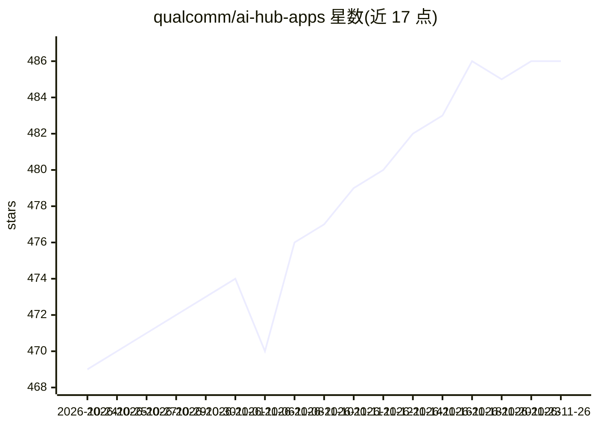

# qualcomm/ai-hub-apps

⭐ 486 · Python · BSD-3-Clause · 推送 2026-11-25 · [GitHub](https://github.com/qualcomm/ai-hub-apps) · 组织维护

**面向 Qualcomm 设备的端侧 ML 示例应用与教程集**

Qualcomm AI Hub Apps 收录一系列示例应用与教程，用于在 Qualcomm 设备上部署机器学习模型，每个应用配合 Qualcomm AI Hub Models 中一个或多个模型使用。支持的推理运行时包括 TensorFlow Lite、ONNX 与 Genie SDK（基于 QNN 的生成式 AI 运行时）；部署目标覆盖 Android 11+、Windows 11 与 Ubuntu 24.04+，计算单元支持 CPU/GPU/NPU。NPU 加速依赖特定 Snapdragon 芯片型号及 FP16/INT8/INT16 权重格式，部分应用在非 Snapdragon 芯片上仅能脱离 NPU 运行。许可证为 BSD-3。

## 筛选速览

| 维度 | 判定 | 备注 |
|---|---|---|
| AI 角色 | `ai-native` | 本体是模型或模型工具 |
| 许可风险 | `permissive` | BSD-3-Clause |
| 部署形态 | `None` |  |
| 模型依赖 | — | README 未给出锁定关系 |
| 硬件要求 | — | 无带数字的原话,不猜 |
| 安装摩擦 | `low` | 无编译、无系统依赖或容器化 |
| 成熟度 | — | 结构信号不足 |

## 能力要点

- 按 Android/Windows/Ubuntu 目录组织的示例应用，覆盖图像分类、目标检测、语音转文本、图像生成、分割等任务
- 支持 TensorFlow Lite、ONNX、Genie SDK 三种推理运行时
- NPU 加速支持 Snapdragon X Elite/8 Elite 等芯片，权重格式要求 FP16 或 INT8/INT16
- 提供 LLM 端侧部署教程（Genie SDK 与 GenieX 运行时）

## 适用场景

- 在 Snapdragon 设备上运行端侧图像分类、目标检测等示例应用
- 参照教程将 LLM 导出并部署到 Qualcomm 设备
- 按开源 app recipe 在本地设备上运行 AI Hub Models 的模型

## 场景标签

`图像生成` `教程课程` `目标检测` · 领域:内容生成

## 证据(README 行号)

> L3: The Qualcomm® AI Hub Apps are a collection of sample apps and tutorials to help deploy machine learning models on Qu
> L8: * Explore apps optimized for on-device deployment of various machine learning tasks.
> L25: * CPU, GPU, NPU (includes hexagon HTP)

## 星数曲线

2026-10-24 469 → 2026-11-26 486（+17）

---
*卡片 v1 · prompt 1.4 · 生成 2026-11-25 · 置信度 high · 依据 README sha `4e26aa392e64` · [字段定义](../../DATASET.md)*
