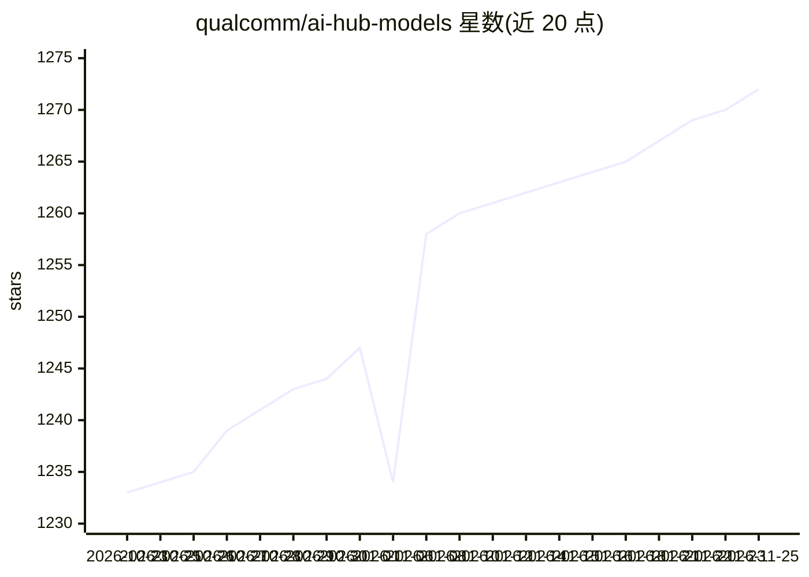

# qualcomm/ai-hub-models

⭐ 1,272 · Python · BSD-3-Clause · 推送 2026-11-24 · [GitHub](https://github.com/qualcomm/ai-hub-models) · [官网](https://aihub.qualcomm.com/models) · 组织维护

**面向 Qualcomm 设备部署的优化 ML 模型集合**

高通官方维护的机器学习模型库，收录生成式 AI 与计算机视觉类模型（文本生成、图像分类、超分辨率、语义分割等），模型针对性能（延迟、内存）优化。提供 qai-hub-models CLI 浏览目录、下载可部署资产（TFLite/ONNX/QNN 等运行时格式），并借助 Qualcomm AI Hub Workbench 在云端托管真机上进行量化、编译、性能剖析与评估。以 pip 包分发，需 Qualcomm ID 与 API token 使用云端流程；Windows ARM64 Python 不受支持。

## 筛选速览

| 维度 | 判定 | 备注 |
|---|---|---|
| AI 角色 | `ai-ecosystem` | LLM/agent 周边工具 |
| 许可风险 | `permissive` | BSD-3-Clause |
| 部署形态 | `library` | 以包/库形式分发 |
| 模型依赖 | — | README 未给出锁定关系 |
| 硬件要求 | — | 无带数字的原话,不猜 |
| 安装摩擦 | `low` | 无编译、无系统依赖或容器化 |
| 成熟度 | — | 结构信号不足 |

## 能力要点

- 提供 CLI 浏览模型目录、查看性能与评估数据并下载可部署资产
- 支持导出到 Qualcomm AI Engine Direct、LiteRT (TFLite)、ONNX 三类设备端运行时
- 覆盖 CPU/GPU/NPU 计算单元，支持 FP32/FP16/INT8/INT16 精度量化
- 面向 Snapdragon 手机、PC、汽车、IoT、XR 等平台芯片

## 适用场景

- 为 Snapdragon 设备准备可直接部署的量化模型
- 在云端托管真机上剖析模型延迟与内存表现
- 下载 TFLite/ONNX 等格式的部署资产用于端侧应用
- 按类别查找可部署的视觉与生成式 AI 模型

## 场景标签

`模型量化` · 领域:训练与推理

## 证据(README 行号)

> L8: The Qualcomm® AI Hub Models are a collection of
> L61: All models in our directory can be compiled and profiled on a hosted
> L89: Export and evaluate use _Qualcomm® AI Hub Workbench_ to:

## 星数曲线

2026-10-23 1,233 → 2026-11-25 1,272（+39）

---
*卡片 v1 · prompt 1.4 · 生成 2026-11-23 · 置信度 high · 依据 README sha `a89f57386590` · [字段定义](../../DATASET.md)*
