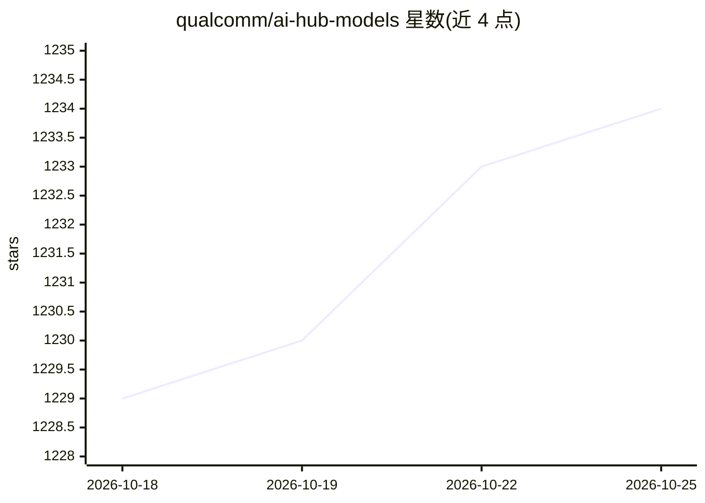

# qualcomm/ai-hub-models

⭐ 1,235 · Python · BSD-3-Clause · 推送 2026-10-23 · [GitHub](https://github.com/qualcomm/ai-hub-models) · [官网](https://aihub.qualcomm.com/models) · 组织维护

**Qualcomm 设备用的优化模型库：浏览、导出并部署 ML 模型**

Qualcomm 维护的机器学习模型集合与配套 Python CLI：收录生成式 AI、计算机视觉等类别模型，提供浏览目录、下载可部署资产、查看性能/精度数据的能力；通过 Qualcomm AI Hub Workbench 可将模型量化、编译为 tflite/ONNX/QNN 等运行时格式，并在云端真机上剖析与评测。支持 Snapdragon 手机、计算、汽车与 IoT 芯片系列，导出需 Qualcomm ID 与 API token。本地演示可经 PyTorch 在 CPU/GPU 运行。

## 筛选速览

| 维度 | 判定 | 备注 |
|---|---|---|
| AI 角色 | `ai-ecosystem` | LLM/agent 周边工具 |
| 许可风险 | `permissive` | BSD-3-Clause |
| 部署形态 | `library` | 以包/库形式分发 |
| 模型依赖 | — | README 未给出锁定关系 |
| 硬件要求 | — | 无带数字的原话,不猜 |
| 安装摩擦 | `low` | 无编译、无系统依赖或容器化 |
| 成熟度 | — | 结构信号不足 |

## 能力要点

- CLI 支持浏览目录、下载资产、查看性能与精度结果
- 经 AI Hub Workbench 量化、编译并在云端真机剖析/评测模型
- 支持 Qualcomm AI Engine Direct、LiteRT、ONNX 运行时与多种精度
- 提供带前后处理的 Python 示例应用与端到端 demo

## 适用场景

- 为 Snapdragon 设备查找并下载优化过的 ML 模型
- 把 PyTorch 模型量化编译为端侧运行时并测性能
- 在真机上跑通模型端到端推理示例

## 场景标签

`模型量化` · 领域:训练与推理

## 证据(README 行号)

> L8: The Qualcomm® AI Hub Models are a collection of
> L61: All models in our directory can be compiled and profiled on a hosted
> L89: Export and evaluate use _Qualcomm® AI Hub Workbench_ to:

## 星数曲线

2026-10-18 1,229 → 2026-10-25 1,234（+5）

---
*卡片 v1 · prompt 1.4 · 生成 2026-10-21 · 置信度 high · 依据 README sha `7fa9979d12db` · [字段定义](../../DATASET.md)*
