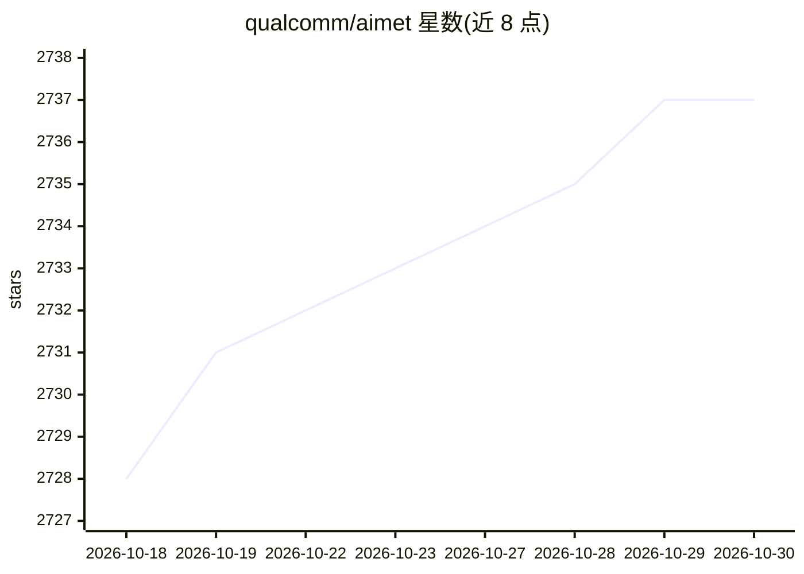

# qualcomm/aimet

⭐ 2,737 · Python · NOASSERTION · 推送 2026-10-29 · [GitHub](https://github.com/qualcomm/aimet) · [官网](https://quic.github.io/aimet-pages/index.html) · 组织维护

**面向已训练 ML 模型的量化与压缩工具库**

由 Qualcomm Innovation Center 维护的模型效率工具包：对训练好的深度学习模型做训练后量化（PTQ，含 AdaRound、SeqMSE、Cross Layer Equalization 等技术）、量化感知训练（QAT，仅 aimet-torch）与模型压缩（Spatial SVD、通道剪枝），以减小模型体积与推理算力，便于部署到手机等边缘设备。支持 ONNX 与 PyTorch 框架的模型，提供可在 PyTorch 管线中直接调用的 API；以 aimet-onnx 与 aimet-torch 包发布在 PyPI，也可在 Docker 环境从源码构建。

## 筛选速览

| 维度 | 判定 | 备注 |
|---|---|---|
| AI 角色 | `ai-ecosystem` | LLM/agent 周边工具 |
| 许可风险 | `none` | NOASSERTION |
| 部署形态 | `library` | 以包/库形式分发 |
| 模型依赖 | — | README 未给出锁定关系 |
| 硬件要求 | — | 无带数字的原话,不猜 |
| 安装摩擦 | `low` | 无编译、无系统依赖或容器化 |
| 成熟度 | — | 结构信号不足 |

## 能力要点

- PTQ 技术覆盖 Calibration、AdaRound、SeqMSE、SpinQuant 等多种方法
- QAT 仅在 aimet-torch 中支持，兼容循环模型（RNN/LSTM/GRU）
- Spatial SVD 与通道剪枝实现约 50% MAC 压缩并保持精度
- 支持 ONNX 与 PyTorch 模型，提供 PyPI 包

## 适用场景

- 把 FP32 模型量化为 INT8/INT4 以便部署到边缘设备
- 压缩模型降低推理时的计算量与内存占用
- 在 PyTorch 管线中直接调用量化 API 自动优化模型

## 场景标签

`模型量化` · 领域:训练与推理

## 证据(README 行号)

> L5: AIMET is a software toolkit for quantizing trained ML models.
> L11: AIMET supports models from the ONNX and PyTorch frameworks.

## 星数曲线

2026-10-18 2,728 → 2026-10-30 2,737（+9）

---
*卡片 v1 · prompt 1.4 · 生成 2026-10-21 · 置信度 high · 依据 README sha `d4f320c0d16a` · [字段定义](../../DATASET.md)*
