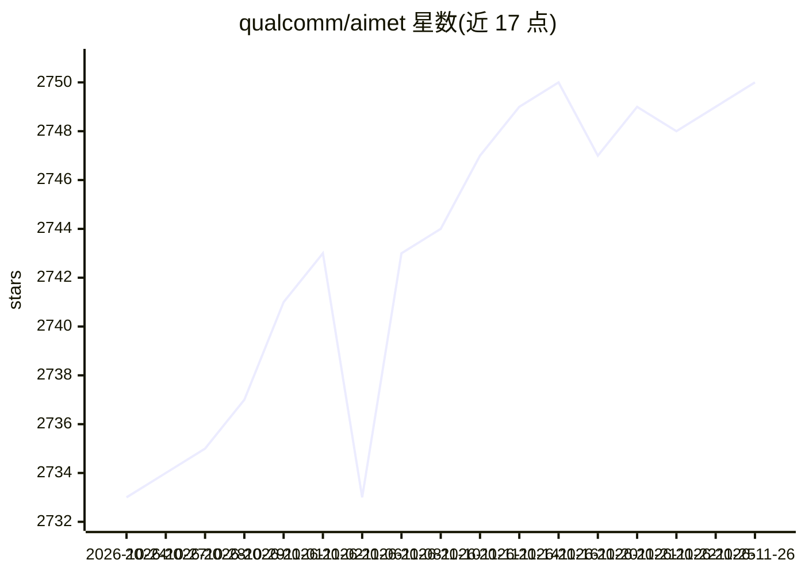

# qualcomm/aimet

⭐ 2,750 · Python · NOASSERTION · 推送 2026-11-25 · [GitHub](https://github.com/qualcomm/aimet) · [官网](https://qualcomm.github.io/aimet-pages/releases/latest/index.html) · 组织维护

**给开发者量化压缩已训练神经网络的模型优化工具库**

Qualcomm Innovation Center 维护的模型量化与压缩工具库：对已训练的 PyTorch/ONNX 模型做训练后量化（Calibration、AdaRound、SeqMSE、OmniQuant、SpinQuant 等）、量化感知训练（QAT）以及空间 SVD 与通道剪枝等压缩，目标是降低内存占用与计算量、便于在手机/笔记本等边缘设备部署，并以 API 形式嵌入 PyTorch 流水线；README 给出 MobileNet-v2、ResNet-50、DeepLabv3、DeepSpeech2 等模型的量化前后精度数据。aimet-onnx 与 aimet-torch 通过 PyPI 分发，也可从源码构建。

## 筛选速览

| 维度 | 判定 | 备注 |
|---|---|---|
| AI 角色 | `ai-ecosystem` | LLM/agent 周边工具 |
| 许可风险 | `none` | NOASSERTION |
| 部署形态 | `library` | 以包/库形式分发 |
| 模型依赖 | — | README 未给出锁定关系 |
| 硬件要求 | — | 无带数字的原话,不猜 |
| 安装摩擦 | `low` | 无编译、无系统依赖或容器化 |
| 成熟度 | — | 结构信号不足 |

## 能力要点

- 支持 ONNX 与 PyTorch 模型的训练后量化（PTQ）与量化感知训练（QAT）
- 提供空间 SVD、通道剪枝与逐层压缩率自动选择等压缩技术
- 支持 RNN/LSTM/GRU 等循环模型的量化仿真与 QAT
- aimet-onnx 与 aimet-torch 包可在 PyPI 获取

## 适用场景

- 把 32 位浮点模型量化为 8 位定点模型用于边缘设备部署
- 在压缩模型时把精度损失控制在可接受范围内
- 在 PyTorch 训练流水线中调用量化感知训练 API

## 场景标签

`模型量化` · 领域:训练与推理

## 证据(README 行号)

> L5: AIMET is a software toolkit for quantizing trained ML models.
> L11: AIMET supports models from the ONNX and PyTorch frameworks.
> L23: * **Advanced quantization techniques**: Inference using integer runtimes is significantly faster than using floatin

## 星数曲线

2026-10-24 2,733 → 2026-11-26 2,750（+17）

---
*卡片 v1 · prompt 1.4 · 生成 2026-11-24 · 置信度 high · 依据 README sha `606f54f0ddfe` · [字段定义](../../DATASET.md)*
