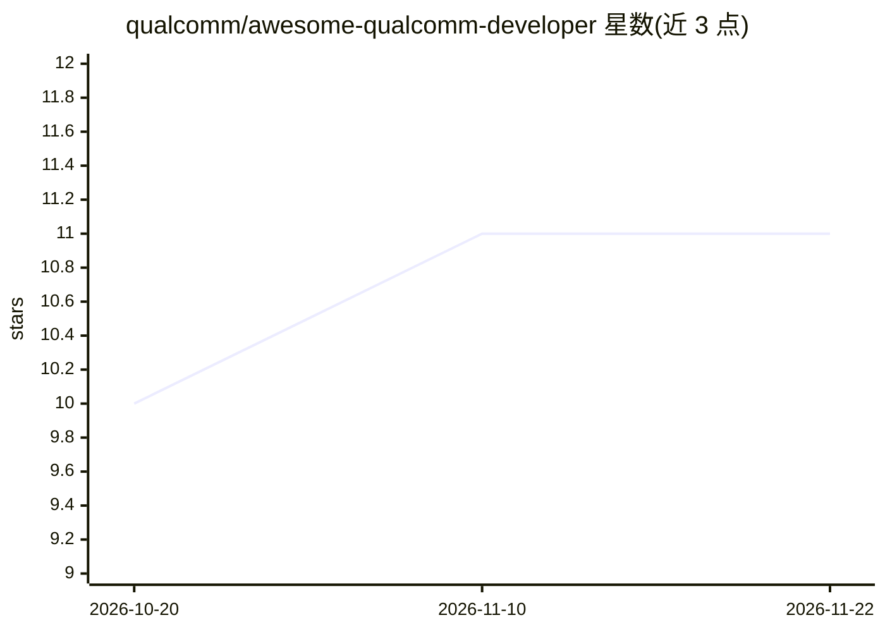

# qualcomm/awesome-qualcomm-developer

⭐ 11 · JavaScript · BSD-3-Clause · 推送 2026-11-21 · [GitHub](https://github.com/qualcomm/awesome-qualcomm-developer) · [官网](https://qualcomm.github.io/awesome-qualcomm-developer/) · 组织维护

**面向开发者的 Qualcomm 平台开源项目目录清单**

由 Qualcomm 维护的策展型清单，收录基于 Snapdragon Compute、Dragonwing IoT、Cloud AI 等平台构建的开源项目与代码示例。仓库声明其为社区导向的参考目录，所列项目不由 Qualcomm 拥有或背书，仅用于帮助开发者发现相关资源。README 本身未列出具体项目内容，主要说明贡献流程、分支策略与本地站点运行方式（npm 启动）。采用 BSD-3-clause 许可证。

## 筛选速览

| 维度 | 判定 | 备注 |
|---|---|---|
| AI 角色 | `ai-knowledge` | 知识聚合/清单类 |
| 许可风险 | `permissive` | BSD-3-Clause |
| 部署形态 | `library` | 以包/库形式分发 |
| 模型依赖 | — | README 未给出锁定关系 |
| 硬件要求 | — | 无带数字的原话,不猜 |
| 安装摩擦 | `low` | 无编译、无系统依赖或容器化 |
| 成熟度 | — | 结构信号不足 |

## 能力要点

- 收录 Snapdragon Compute / Dragonwing IoT / Cloud AI 平台的开源项目
- 声明为 Qualcomm 策展的第三方项目参考目录
- 提供本地站点预览方式（npm install + npm run start-local）

## 适用场景

- 为 Qualcomm 平台开发寻找相关开源项目
- 浏览边缘 AI / IoT / 云 AI 方向的社区项目资源

## 场景标签

`精选清单` · 领域:学习与行业

## 证据(README 行号)

> L3: Welcome! This repo is for cataloging OSS projects that build upon Qualcomm's platforms such as
> L33: This repository is a **Qualcomm-curated catalog** of publicly available code samples and projects that may be of in

## 星数曲线

2026-10-20 10 → 2026-11-22 11（+1）

---
*卡片 v1 · prompt 1.4 · 生成 2026-11-18 · 置信度 high · 依据 README sha `9b16571ec91a` · [字段定义](../../DATASET.md)*
