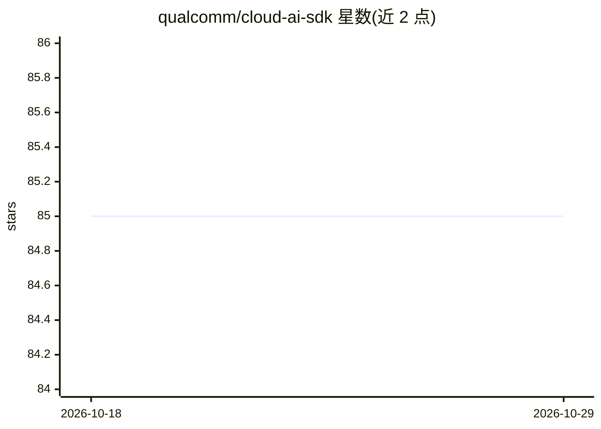

# qualcomm/cloud-ai-sdk

⭐ 85 · Jupyter Notebook · NOASSERTION · 推送 2026-10-07 · [GitHub](https://github.com/qualcomm/cloud-ai-sdk) · [官网](https://quic.github.io/cloud-ai-sdk-pages/latest/) · 组织维护

**高通 Cloud AI 100 加速器的模型部署教程与示例资源库**

面向开发者的 Qualcomm Cloud AI 100 平台开发资源仓库，提供三类内容：CV/NLP/多模态模型的部署 recipe（LLM、embedding、语音模型指向 efficient-transformers 仓库）、模型接入与性能调优教程、Python/C++ API 使用示例。支持 vLLM 容器运行 LLM、Open WebUI 教程、Kubernetes 部署，以及 Llama、MPT、StarCoder、Stable Diffusion、Whisper、YOLOv8、DETR 等模型示例。仓库不包含模型本体，模型由第三方提供；文档采用 BSD 3-clause-Clear 许可。

## 筛选速览

| 维度 | 判定 | 备注 |
|---|---|---|
| AI 角色 | `ai-ecosystem` | LLM/agent 周边工具 |
| 许可风险 | `none` | NOASSERTION |
| 部署形态 | `self-host` | docker 或自建部署 |
| 模型依赖 | local-ok | 支持本地模型 |
| 硬件要求 | — | 无带数字的原话,不猜 |
| 安装摩擦 | `low` | 无编译、无系统依赖或容器化 |
| 成熟度 | — | 结构信号不足 |

## 能力要点

- 覆盖 YOLO/ResNet/ViT/Mask R-CNN 等 CV 模型与 80+ NLP encoder 模型的部署 recipe
- 提供 vLLM 容器方式运行 LLM 的快速启动流程
- 含模型接入、性能调优、profiling 教程与 Python/C++ 示例代码
- QAic Bench 脚本支持 vLLM 0.10 基准测试

## 适用场景

- 在 Cloud AI 100 加速器上部署 CV/NLP/LLM 模型推理
- 学习模型接入与性能调优的方法
- 用 vLLM 在加速器上搭建 LLM 推理服务

## 场景标签

`推理引擎` `教程课程` · 领域:学习与行业

## 证据(README 行号)

> L35: Qualcomm Cloud AI 100 offers a unique blend of high computational performance, low latency, and low power utilizati
> L37: This repository provides developers with 3 key resources
> L40: - Samples - Sample code illustrating usage of APIs - Python and C++ for inference on Cloud AI platforms

## 星数曲线

2026-10-18 85 → 2026-10-29 85（+0）

---
*卡片 v1 · prompt 1.4 · 生成 2026-10-24 · 置信度 high · 依据 README sha `24b45082139e` · [字段定义](../../DATASET.md)*
