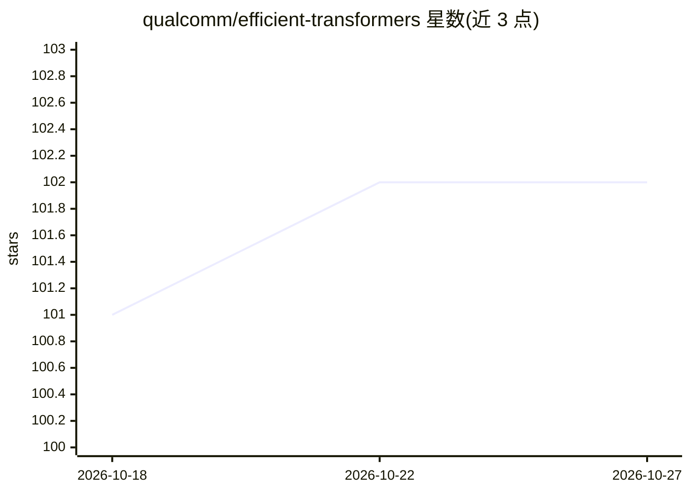

# qualcomm/efficient-transformers

⭐ 102 · Python · NOASSERTION · 推送 2026-10-25 · [GitHub](https://github.com/qualcomm/efficient-transformers) · [官网](https://qualcomm.github.io/efficient-transformers/) · 组织维护

**把 HuggingFace 模型移植到高通 Cloud AI 加速卡的推理库**

高通维护的 Python 库，提供 LLM 模块重实现、图变换（低精度执行、等价算子替换）、权重映射 Patcher 与 ONNX 导出器，将 HuggingFace transformers 训练的预训练模型（Llama、Qwen、Gemma、GLM、Mistral 等大量家族）编译为可在 Qualcomm Cloud AI100/AI200 等加速卡上运行的推理格式。支持 FP8/AWQ/GPTQ 量化模型、PEFT 适配器、投机解码、连续批处理与分离式 serving，并附带示例应用、notebook 与单元测试模板。

## 筛选速览

| 维度 | 判定 | 备注 |
|---|---|---|
| AI 角色 | `ai-ecosystem` | LLM/agent 周边工具 |
| 许可风险 | `none` | NOASSERTION |
| 部署形态 | `None` |  |
| 模型依赖 | local-ok | 支持本地模型 |
| 硬件要求 | — | 无带数字的原话,不猜 |
| 安装摩擦 | `low` | 无编译、无系统依赖或容器化 |
| 成熟度 | — | 结构信号不足 |

## 能力要点

- 重实现 LLM 模块并导出为 ONNX 图以适配高通 Cloud AI 加速卡
- 支持 FP8、AWQ/GPTQ 4-bit 量化与 PEFT 模型推理
- 覆盖预填充/解码分离编译、连续批处理与投机解码
- 提供示例应用、demo notebook 与单元测试模板

## 适用场景

- 把 HuggingFace 上的预训练模型部署到 Qualcomm Cloud AI100/AI200
- 在低精度下编译并运行 LLM/VLM/嵌入模型
- 对模型做量化与图优化后导出 ONNX

## 场景标签

`推理引擎` `模型量化` · 领域:训练与推理

## 证据(README 行号)

> L80: This library provides reimplemented blocks of LLMs which are used to make the models functional and highly performa
> L84: ## Typically for LLMs, the library provides:
> L90: 6. Exporter module to export the model source into a `ONNX` Graph.

## 星数曲线

2026-10-18 101 → 2026-10-27 102（+1）

---
*卡片 v1 · prompt 1.4 · 生成 2026-10-23 · 置信度 high · 依据 README sha `400e3161e86b` · [字段定义](../../DATASET.md)*
