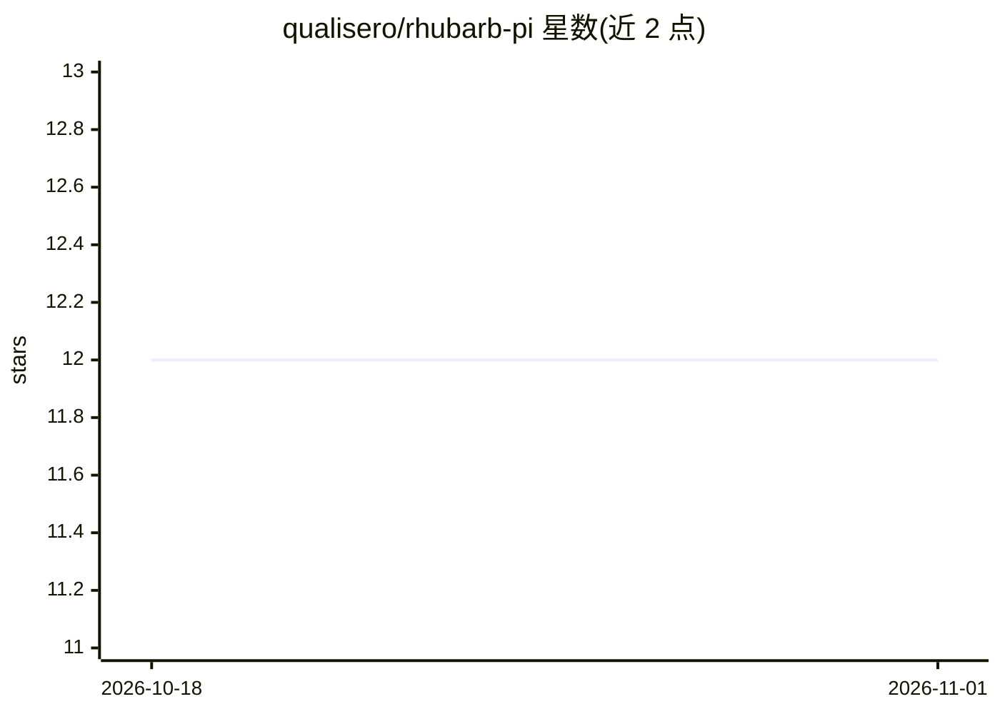

# qualisero/rhubarb-pi

⭐ 12 · TypeScript · MIT · 推送 2026-01-25 · [GitHub](https://github.com/qualisero/rhubarb-pi) · 个人维护

**pi 编码代理的小型钩子与扩展合集**

为 pi coding agent 提供的 5 个扩展模块：background-notify 在终端后台时对长任务完成播放提示音并将终端置前（macOS）；session-emoji 用 AI 分析对话上下文在页脚显示表情符号；session-color 以 40 色带区分会话；safe-git 对高危 git 操作（force push、hard reset）要求确认并在非交互模式阻止；pi-agent-scip 基于 Sourcegraph SCIP 索引器提供代码定义跳转、引用查找等工具。各模块通过 npm run install:<name> 安装，需 pi v0.36.0+ 与 Node.js 20+，background-notify 的终端激活仅限 macOS。

## 筛选速览

| 维度 | 判定 | 备注 |
|---|---|---|
| AI 角色 | `ai-ecosystem` | LLM/agent 周边工具 |
| 许可风险 | `permissive` | MIT |
| 部署形态 | `None` |  |
| 模型依赖 | — | README 未给出锁定关系 |
| 硬件要求 | — | 无带数字的原话,不猜 |
| 安装摩擦 | `low` | 无编译、无系统依赖或容器化 |
| 成熟度 | — | 结构信号不足 |

## 能力要点

- 5 个模块覆盖通知、会话视觉标识、git 安全、代码智能导航
- pi-agent-scip 提供基于 SCIP 的定义跳转/引用查找/符号搜索
- safe-git 按风险分级拦截 git 操作，非交互模式完全阻止
- 支持 npm run install:all 一键安装与 uninstall 卸载

## 适用场景

- 在 pi 代理执行长任务时收到完成通知
- 降低编码代理误执行高危 git 命令的风险
- 在多个会话间用颜色和表情快速区分

## 场景标签

 · 领域:开发者工具/AI代理扩展

## 证据(README 行号)

> L3: A collection of extensions for the pi coding agent.
> L117: - pi coding agent v0.36.0+

## 星数曲线

2026-10-18 12 → 2026-11-01 12（+0）

---
*卡片 v1 · prompt 1.4 · 生成 2026-11-01 · 置信度 high · 依据 README sha `2f78991133c8` · [字段定义](../../DATASET.md)*
