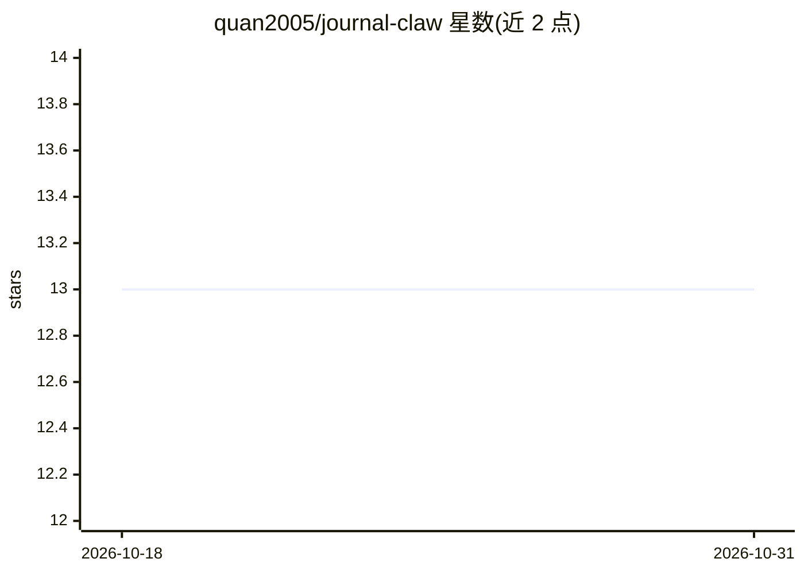

# quan2005/journal-claw

⭐ 13 · TypeScript · 推送 2026-08-01 · [GitHub](https://github.com/quan2005/journal-claw) · [官网](https://quan2005.github.io/journal-claw/) · 个人维护 · 中文 README

**macOS 桌面 AI 知识库：投喂原始材料，LLM 自动整理成知识条目**

面向知识工作者的 macOS 桌面应用：用户不手写笔记，而是投入 PDF/DOCX/TXT 文件或粘贴文本，内置 LLM 引擎将其增量编译为结构化 Markdown 知识条目（标题、标签、摘要、正文），沿时间线形成个人记忆系统，并提供基于知识库的对话问答、来源溯源、人物/项目画像、定时知识库维护（矛盾检测、概念抽取）与待办提取。支持 Anthropic、火山引擎、智谱、DashScope 多厂商，可通过 SKILL.md 插件扩展处理流程，经 WebSocket 接入飞书消息。Electron + React 19 + TypeScript daemon 构建，Releases 提供 .dmg 安装包。

## 筛选速览

| 维度 | 判定 | 备注 |
|---|---|---|
| AI 角色 | `ai-native` | 本体是模型或模型工具 |
| 许可风险 | `none` | — |
| 部署形态 | `desktop` | 安装包/桌面程序 |
| 模型依赖 | locked-api |  |
| 硬件要求 | — | 无带数字的原话,不猜 |
| 安装摩擦 | `low` | 无编译、无系统依赖或容器化 |
| 成熟度 | — | 结构信号不足 |

## 能力要点

- LLM 将原始材料增量编译为结构化 Markdown 知识条目
- 知识条目按时间线组织并链接回原始材料来源
- 对话/Agent 模式问答，流式响应
- 支持 Anthropic、火山引擎、智谱 AI、阿里 DashScope 多厂商

## 适用场景

- 把文档、会议记录、网页摘录丢进去，让 AI 自动整理成可检索的知识库
- 围绕个人知识库提问并获得带来源的分析
- 为人物、项目、概念建立画像辅助 AI 理解上下文

## 场景标签

`知识库管理` `文档问答` · 领域:知识与检索

## 证据(README 行号)

> L7: JournalClaw is a macOS desktop app — an AI-powered knowledge base for knowledge workers. You don't write notes. You 
> L29: - **AI compilation** — Built-in LLM engine compiles raw materials into structured Markdown: title, tags, summary, b

## 星数曲线

2026-10-18 13 → 2026-10-31 13（+0）

---
*卡片 v1 · prompt 1.4 · 生成 2026-10-31 · 置信度 high · 依据 README sha `e973b5db5ee6` · [字段定义](../../DATASET.md)*
