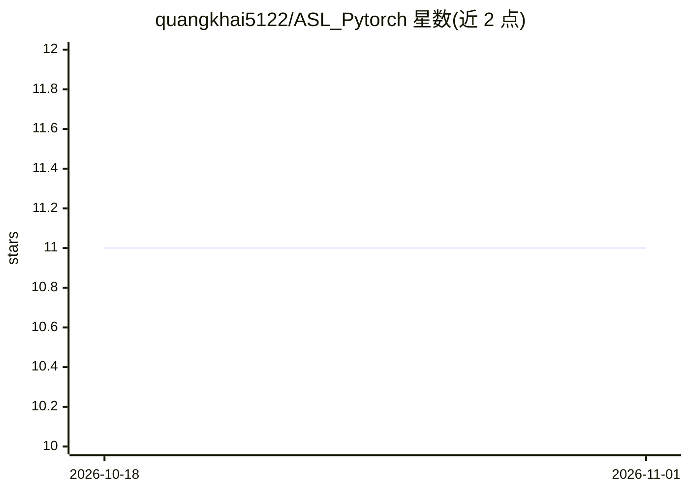

# quangkhai5122/ASL_Pytorch

⭐ 11 · Python · 推送 2026-06-02 · [GitHub](https://github.com/quangkhai5122/ASL_Pytorch) · 个人维护

**面向 Kaggle GISLR 数据集的 ASL 手语词识别 PyTorch 基线**

基于 PyTorch 的孤立美国手语（ASL）单词识别实现，处理 Kaggle GISLR 数据集的 543 点 MediaPipe 关键帧序列。预处理选取嘴唇、主手与部分姿态点，统一为左手优势规范形式，并降采样/填充到 64 帧。模型为 2 层 Transformer 编码器（8 头、384 维、GELU MLP），训练采用标签平滑、AdamW 余弦调度与逐类均衡采样。另含摄像头演示：用 MediaPipe Holistic 识别手语词，再由 Google Gemini 将词序重排为简单句子。提供 venv 环境创建的快速上手说明与 YouTube 演示。

## 筛选速览

| 维度 | 判定 | 备注 |
|---|---|---|
| AI 角色 | `ai-native` | 本体是模型或模型工具 |
| 许可风险 | `none` | — |
| 部署形态 | `None` |  |
| 模型依赖 | — | README 未给出锁定关系 |
| 硬件要求 | — | 无带数字的原话,不猜 |
| 安装摩擦 | `low` | 无编译、无系统依赖或容器化 |
| 成熟度 | — | 结构信号不足 |

## 能力要点

- 基于 MediaPipe 关键帧（543 点）的手语词识别管线
- 预处理含特征点选取、左优势手规范化与 64 帧对齐
- Transformer 编码器（2 层、8 头、384 维）实现识别
- 摄像头演示结合 Gemini 将识别词重组为简单句子

## 适用场景

- 在 Kaggle GISLR 数据集上训练手语词识别模型
- 通过摄像头实时识别手语词并生成简单句子
- 复现手语识别的预处理与训练流程作为基线

## 场景标签

 · 领域:计算机视觉/手语识别

## 证据(README 行号)

> L3: This is a PyTorch implementation for isolated ASL word recognition on Kaggle's **GISLR** dataset,
> L4: including an inference demo that turns a stream of recognized words into a **simple sentence** via **Google Generati
> L12: - Webcam demo using MediaPipe Holistic and Gemini to re-order recognized words into a simple sentence.

## 星数曲线

2026-10-18 11 → 2026-11-01 11（+0）

---
*卡片 v1 · prompt 1.4 · 生成 2026-11-01 · 置信度 high · 依据 README sha `1239e7084256` · [字段定义](../../DATASET.md)*
