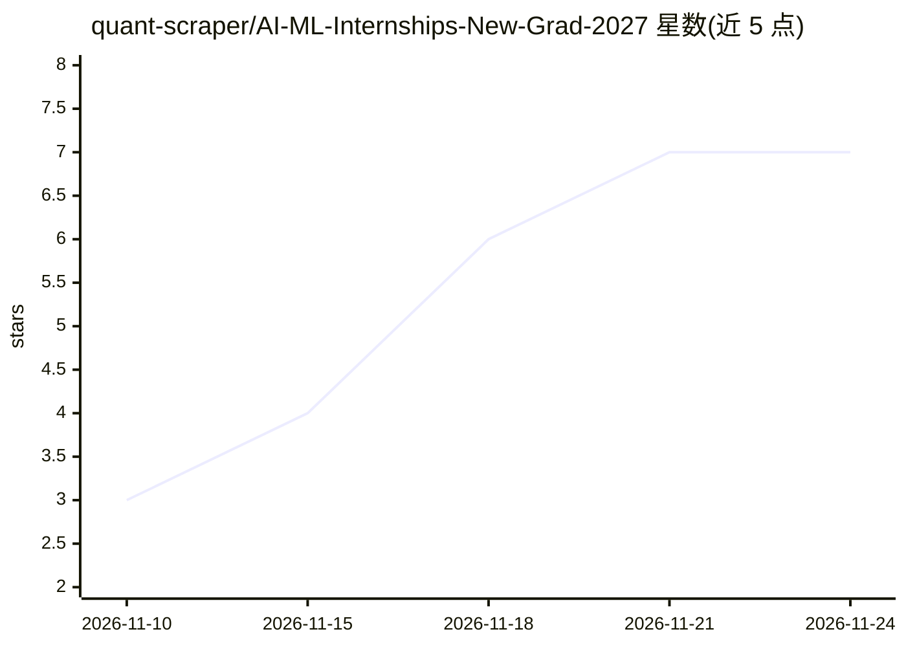

# quant-scraper/AI-ML-Internships-New-Grad-2027

⭐ 8 · 推送 2026-11-23 · [GitHub](https://github.com/quant-scraper/AI-ML-Internships-New-Grad-2027) · [官网](https://quant-scraper.com/ai?for=students) · 组织维护

**面向求职学生的 31 家 AI 公司实习与应届岗位清单**

由 QuantScraper 维护的 2027 年 AI/ML 实习与应届生岗位汇总清单，每六小时从 31 家 AI 实验室与机器学习公司的招聘页面抓取更新，共收录 31 个实习与 28 个应届岗位。按学科（研究/工程技术）与地区（美洲/EMEA/亚太）组织表格，字段含公司、职位、地点、方向与美元年薪；数据由 quant-scraper.com 每次采集后自动生成，链接指向各公司原始招聘页。

## 筛选速览

| 维度 | 判定 | 备注 |
|---|---|---|
| AI 角色 | `ai-knowledge` | 知识聚合/清单类 |
| 许可风险 | `none` | — |
| 部署形态 | `None` |  |
| 模型依赖 | — | README 未给出锁定关系 |
| 硬件要求 | — | 无带数字的原话,不猜 |
| 安装摩擦 | `low` | 无编译、无系统依赖或容器化 |
| 成熟度 | — | 结构信号不足 |

## 能力要点

- 每六小时从 31 家公司官方招聘页抓取更新
- 按学科与地区双维度组织岗位表格
- 标注薪资（美元年薪）与发布日期
- 与 Quant/Big Tech 两个姊妹岗位清单关联

## 适用场景

- 查找 2027 年 AI 方向的实习与应届岗位
- 按研究方向或地区筛选目标公司的招聘信息
- 了解各 AI 实验室应届岗位的薪资水平

## 场景标签

`精选清单` · 领域:学习与行业

## 证据(README 行号)

> L3: Every open internship and graduate role at 31 AI labs and AI & machine learning companies, read from each firm's own
> L103:  Generated from quant-scraper.com after every ingest. Links go to each firm's own posting. Spotted a mistake? Use 

## 星数曲线

2026-11-10 3 → 2026-11-24 7（+4）

---
*卡片 v1 · prompt 1.4 · 生成 2026-11-20 · 置信度 high · 依据 README sha `681711dc9c3e` · [字段定义](../../DATASET.md)*
