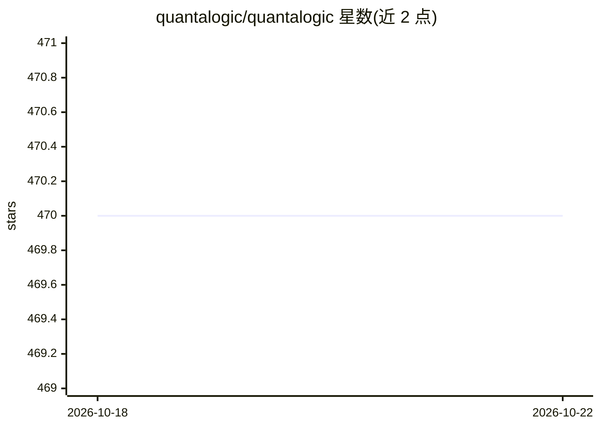

# quantalogic/quantalogic

⭐ 470 · Python · Apache-2.0 · 推送 2026-10-07 · [GitHub](https://github.com/quantalogic/quantalogic) · 组织维护

**Python ReAct/CodeAct 编码与自动化 agent 框架，附 CLI**

基于 LLM 的 Python agent 框架，通过 LiteLLM 接入 OpenAI、Anthropic、DeepSeek 等模型，提供 ReAct（推理+工具循环）、CodeAct（以可执行 Python 代码为动作语言）、Flow（YAML 节点式工作流）与 Chat 四种模式，核心 React 组件带 40+ 工具（代码执行、搜索、文件管理等），支持 Docker 沙箱隔离执行、自定义工具与事件日志。以 pip 包与 CLI（quantalogic / quantalogic_codeact）交付，Python >= 3.10，可选组件按需安装。

## 筛选速览

| 维度 | 判定 | 备注 |
|---|---|---|
| AI 角色 | `ai-ecosystem` | LLM/agent 周边工具 |
| 许可风险 | `permissive` | Apache-2.0 |
| 部署形态 | `library` | 以包/库形式分发 |
| 模型依赖 | — | README 未给出锁定关系 |
| 硬件要求 | — | 无带数字的原话,不猜 |
| 安装摩擦 | `low` | 无编译、无系统依赖或容器化 |
| 成熟度 | — | 结构信号不足 |

## 能力要点

- ReAct / CodeAct / Flow / Chat 四种模式，CodeAct 以可执行 Python 代码为动作语言
- 核心 React agent 附带 40+ 工具（代码执行、搜索、文件管理等）
- 经 LiteLLM 接入 OpenAI、Anthropic、DeepSeek 等模型
- Docker 沙箱隔离的工具执行与自定义工具扩展

## 适用场景

- 构建会编码、调试脚本的 AI agent
- 用节点/转换定义结构化数据管道与自动化流程
- 通过 CLI 或 Python API 搭建带工具调用的对话助手

## 场景标签

 · 领域:LLM/Agent 开发框架

## 证据(README 行号)

> L26: **What’s the vibe?** QuantaLogic is a Python framework that harnesses LLMs (like GPT-4o, Claude, or DeepSeek) to cr
> L32: - **LLM Integration**: Supports OpenAI, Anthropic, DeepSeek via LiteLLM.
> L53: |**QuantaLogic React**|Core ReAct agent with 40+ tools|General AI tasks, automation, tool-based workflows|📖 Detaile

## 星数曲线

2026-10-18 470 → 2026-10-22 470（+0）

---
*卡片 v1 · prompt 1.4 · 生成 2026-10-21 · 置信度 high · 依据 README sha `d6d88b99247e` · [字段定义](../../DATASET.md)*
