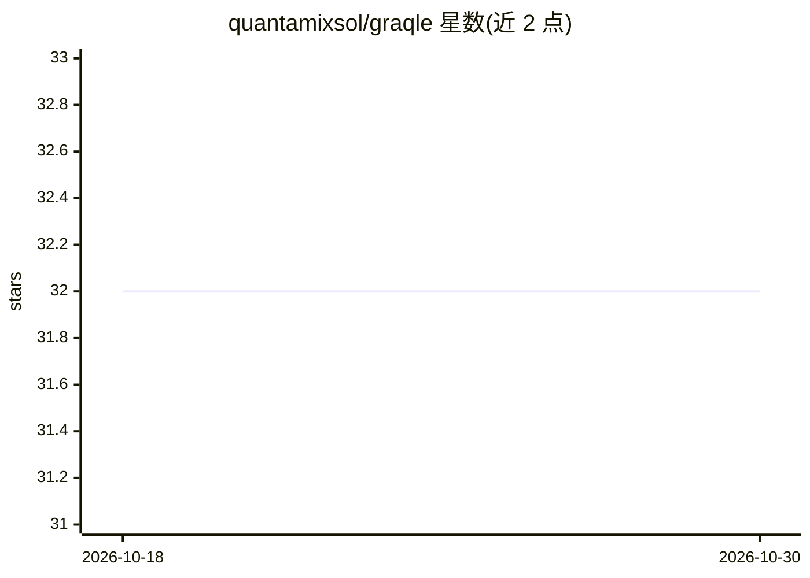

# quantamixsol/graqle

⭐ 32 · Python · NOASSERTION · 推送 2026-10-25 · [GitHub](https://github.com/quantamixsol/graqle) · [官网](https://graqle.com) · 组织维护

**给 AI agent 提供持久组织记忆知识图谱与决策审计门**

面向使用 Claude Code、Cursor、Codex、Copilot 等 AI 编码工具的开发团队：将代码、文档、策略与决策转化为跨会话共享的知识图谱，通过 MCP 服务器（共享服务+轻量 relay）让多个 agent 共用一个图并各自持有权限与文件。核心机制包括决策审计门（输出 EXECUTE/REPLAN/HOLD/REJECT/ESCALATE 五种判定、按维度度量置信度、签名哈希链溯源记录，默认关闭需显式开启），支持 Anthropic/OpenAI/Bedrock/Ollama/Gemini 等 13 种 LLM 后端或完全离线。本地优先、无遥测。提供 Free/Pro/Team/Enterprise 多档版本，核心方法专利申请中，采用 GraQle License。

## 筛选速览

| 维度 | 判定 | 备注 |
|---|---|---|
| AI 角色 | `ai-ecosystem` | LLM/agent 周边工具 |
| 许可风险 | `none` | NOASSERTION |
| 部署形态 | `library` | 以包/库形式分发 |
| 模型依赖 | — | README 未给出锁定关系 |
| 硬件要求 | — | 无带数字的原话,不猜 |
| 安装摩擦 | `low` | 无编译、无系统依赖或容器化 |
| 成熟度 | — | 结构信号不足 |

## 能力要点

- 代码/文档/策略转化为持久共享知识图谱（graq scan 命令）
- 决策审计门：五值判定+签名哈希链溯源+按维度置信度，默认关闭
- MCP 共享服务器+relay 架构，多 agent 各自权限共用一个图
- 13 种 LLM 后端（Anthropic/OpenAI/Bedrock/Ollama/Gemini 等）或完全离线

## 适用场景

- 让团队中多个 AI 编码工具共享同一份组织知识记忆
- 在 agent 执行动作前做策略合规与证据校验审计
- 为受监管工作留存可验证的决策溯源记录

## 场景标签

`Agent 记忆` `知识图谱` `多智能体` · 领域:Agent 开发

## 证据(README 行号)

> L20: 1. **Remembers.** Turns your code, documents, policies and decisions into one connected knowledge graph that lasts 
> L22: 3. **Shares.** One graph serves a whole team of agents - Claude Code, Cursor, Codex, Copilot - each with its own pe
> L88: graq mcp serve --transport http --port 8765 --config graqle.yaml --allowed-roots /path/to/projects

## 星数曲线

2026-10-18 32 → 2026-10-30 32（+0）

---
*卡片 v1 · prompt 1.4 · 生成 2026-10-25 · 置信度 high · 依据 README sha `294c0e3383aa` · [字段定义](../../DATASET.md)*
