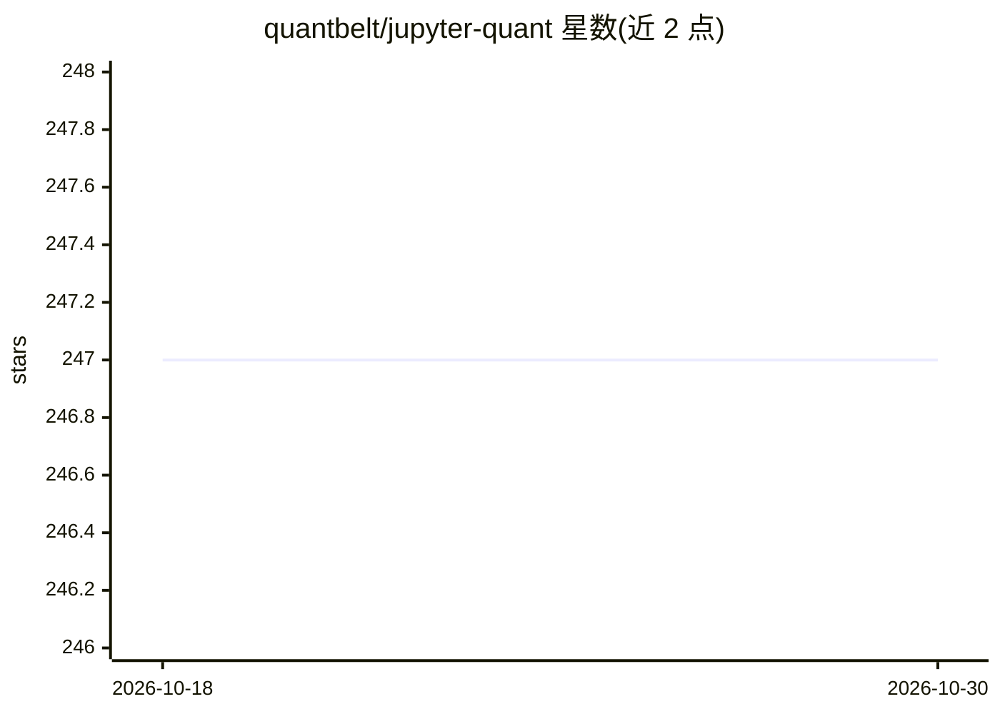

# quantbelt/jupyter-quant

⭐ 247 · Shell · Apache-2.0 · 推送 2026-10-29 · [GitHub](https://github.com/quantbelt/jupyter-quant) · 个人维护

**Docker 化的 Jupyter 量化研究环境，预装量化与统计包**

面向量化研究者的 JupyterLab 容器化环境，以 Docker 镜像或 pypi 元包两种形式提供。镜像内置 zipline-reloaded、pyfolio-reloaded、alphalens-reloaded、PyPortfolioOpt、statsmodels、pymc、arch 等量化与统计包，以及 numpy/pandas/scikit-learn/shap/optuna 等常用库，并通过 ib_async 支持接入 Interactive Brokers（配合 IB Gateway 镜像）。设计为临时容器模式，通过三个卷分离保存包、配置与笔记本；含 Cython/Numba 加速组件，不内置 conda/mamba，不含编译环境，可自行构建 wheel 导入。

## 筛选速览

| 维度 | 判定 | 备注 |
|---|---|---|
| AI 角色 | `ai-enhanced` | 去掉 AI 部分产品仍成立 |
| 许可风险 | `permissive` | Apache-2.0 |
| 部署形态 | `self-host` | docker 或自建部署 |
| 模型依赖 | — | README 未给出锁定关系 |
| 硬件要求 | — | 无带数字的原话,不猜 |
| 安装摩擦 | `low` | 无编译、无系统依赖或容器化 |
| 成熟度 | — | 结构信号不足 |

## 能力要点

- Docker 镜像或 pip 元包两种安装形式，元包锁定依赖版本
- 预装 zipline/pyfolio/alphalens-reloaded、PyPortfolioOpt、statsmodels、pymc 等量化统计包
- ib_async 支持 Interactive Brokers 连接，可配合 IB Gateway 镜像
- 三卷设计支持临时容器：包、配置、笔记本分离持久化

## 适用场景

- 搭建开箱即用的量化研究 Jupyter 环境
- 在容器中做统计/时间序列分析与组合优化
- 通过 Interactive Brokers 网关连接交易接口

## 场景标签

`金融量化` · 领域:学习与行业

## 证据(README 行号)

> L3: A dockerized Jupyter quant research environment.
> L8: - Includes tools for quant analysis, statsmodels, pymc, arch, py_vollib,

## 星数曲线

2026-10-18 247 → 2026-10-30 247（+0）

---
*卡片 v1 · prompt 1.4 · 生成 2026-10-22 · 置信度 high · 依据 README sha `4e7c906c1df4` · [字段定义](../../DATASET.md)*
