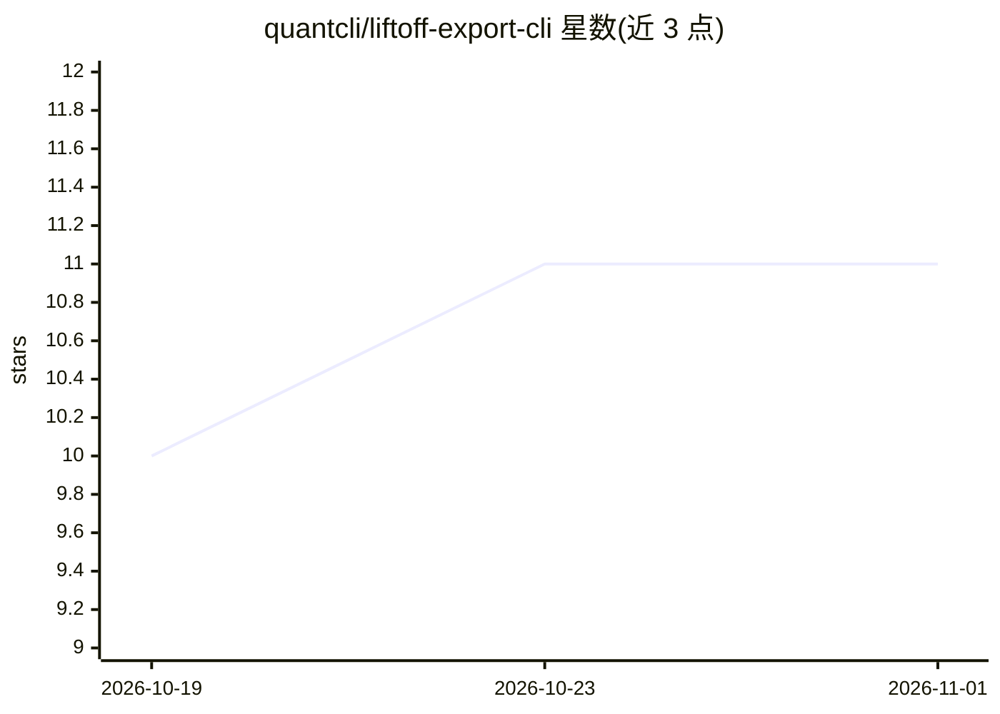

# quantcli/liftoff-export-cli

⭐ 11 · Go · MIT · 推送 2026-10-31 · [GitHub](https://github.com/quantcli/liftoff-export-cli) · 组织维护

**从 Liftoff 健身应用导出并分析训练数据的命令行工具**

非官方的 Go 编写 CLI，登录 Liftoff 账号后可列出、搜索训练记录并以 fitdown 或 JSON 格式输出；支持按动作名称（前缀匹配）与相对/绝对日期过滤，提供逐动作 PR 追踪、容量统计、月度进度条形图，以及体重趋势的 ASCII 图表、平台期检测与变化率分析。默认输出 fitdown 格式，JSON 输出可管道给 jq、脚本或 agent 使用。提供 macOS（Intel/Apple Silicon）、Linux、Windows 预编译二进制，可经 Homebrew 安装。限制：文件夹组织的 routines 尚未渲染。

## 筛选速览

| 维度 | 判定 | 备注 |
|---|---|---|
| AI 角色 | `ai-enhanced` | 去掉 AI 部分产品仍成立 |
| 许可风险 | `permissive` | MIT |
| 部署形态 | `desktop` | 安装包/桌面程序 |
| 模型依赖 | — | README 未给出锁定关系 |
| 硬件要求 | — | 无带数字的原话,不猜 |
| 安装摩擦 | `low` | 无编译、无系统依赖或容器化 |
| 成熟度 | — | 结构信号不足 |

## 能力要点

- 训练记录以 fitdown 或 JSON 格式导出，JSON 可管道给 jq 与 agent
- 逐动作 PR 追踪、容量统计与月度进度图
- 体重趋势 ASCII 图表、平台期检测与变化率分析
- macOS/Linux/Windows 预编译二进制与 Homebrew 安装

## 适用场景

- 备份自己在 Liftoff 记录的健身数据
- 在终端查看动作 PR 与训练容量统计
- 把训练与体重数据以 JSON 接给脚本或 LLM agent 分析

## 场景标签

 · 领域:健康/健身数据工具

## 证据(README 行号)

> L3: Export and analyze your workout data from the Liftoff fitness app. A command-line tool to back up gym sessions, trac
> L113: liftoff-export routines list --format json         # Full JSON for jq / agents

## 星数曲线

2026-10-19 10 → 2026-11-01 11（+1）

---
*卡片 v1 · prompt 1.4 · 生成 2026-11-01 · 置信度 mid · 依据 README sha `c7e292f8b8f7` · [字段定义](../../DATASET.md)*
