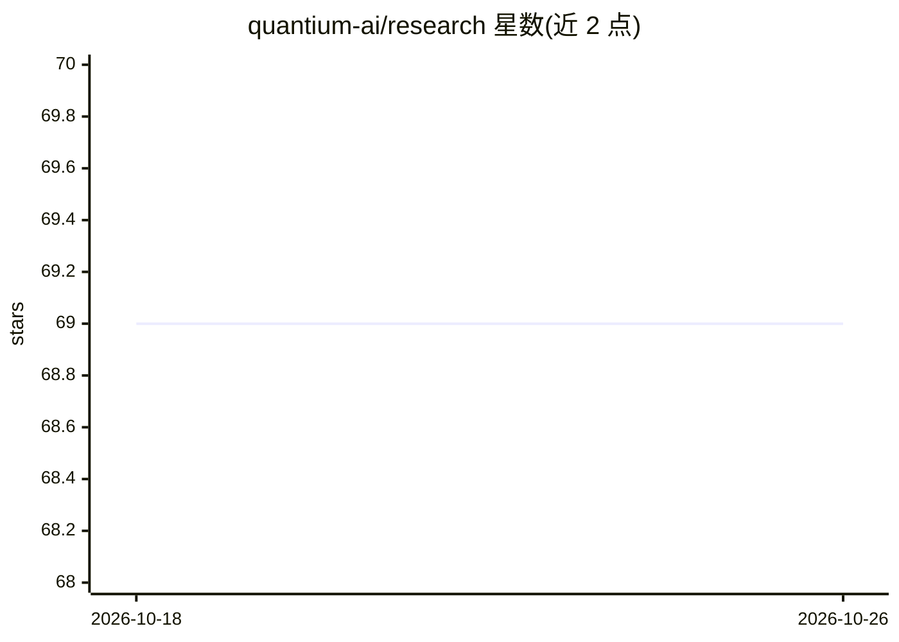

# quantium-ai/research

⭐ 69 · Jupyter Notebook · MIT · 推送 2025-12-19 · [GitHub](https://github.com/quantium-ai/research) · 个人维护

**量化交易策略研究实验集合（Jupyter notebook 形式）**

收录量化交易策略与研究实验的仓库，以 Jupyter notebook 形式实现，展示作者自创或受博客、文章、视频启发的非常见策略想法。每个 notebook 探索不同的市场分析与预测方法，涵盖传统图表技术到机器学习模型（主题标签含 LSTM、Transformers、HMM、GPT）。README 顶部声明该项目仅供教育目的，不构成财务建议，股价预测不保证准确，不应作为投资决策依据。

## 筛选速览

| 维度 | 判定 | 备注 |
|---|---|---|
| AI 角色 | `ai-native` | 本体是模型或模型工具 |
| 许可风险 | `permissive` | MIT |
| 部署形态 | `None` |  |
| 模型依赖 | — | README 未给出锁定关系 |
| 硬件要求 | — | 无带数字的原话,不猜 |
| 安装摩擦 | `low` | 无编译、无系统依赖或容器化 |
| 成熟度 | — | 结构信号不足 |

## 能力要点

- 以 Jupyter notebook 形式组织的策略研究实验
- 涵盖传统图表技术到机器学习模型（LSTM/Transformers/HMM）
- 展示非常见的策略想法与市场分析预测方法

## 适用场景

- 学习量化交易策略的研究实现方式
- 参考机器学习在股价分析预测中的实验做法
- 了解不常见的量化策略思路

## 场景标签

`金融量化` · 领域:学习与行业

## 证据(README 行号)

> L9: This repository contains quantitative trading strategies and research experiments implemented as Jupyter notebooks. 
> L12: from traditional charting techniques to modern machine learning models.

## 星数曲线

2026-10-18 69 → 2026-10-26 69（+0）

---
*卡片 v1 · prompt 1.4 · 生成 2026-10-24 · 置信度 mid · 依据 README sha `1e4bbc6eb254` · [字段定义](../../DATASET.md)*
