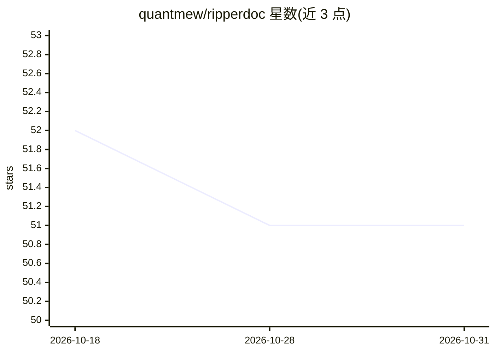

# quantmew/ripperdoc

⭐ 51 · Python · Apache-2.0 · 推送 2026-05-22 · [GitHub](https://github.com/quantmew/ripperdoc) · [官网](https://ripperdoc-docs.pages.dev) · 个人维护 · 中文 README

**终端中的可扩展 AI 编程代理，用自然语言写代码改项目**

运行于终端的开源 AI 编程代理，用户通过自然语言对话完成代码编写、重构、shell 命令执行与文件管理。模型接入 Anthropic Claude、OpenAI、Google Gemini、DeepSeek 及任意 OpenAI 兼容 API；内置 30+ 工具（文件读写、Grep/Glob/LSP、后台 Bash、Jupyter 编辑），支持 MCP 集成、SKILL.md 技能包、生命周期 hooks、任务图与多智能体协作；带权限系统、会话分叉与成本统计。Python 实现，pip 或源码安装。

## 筛选速览

| 维度 | 判定 | 备注 |
|---|---|---|
| AI 角色 | `ai-native` | 本体是模型或模型工具 |
| 许可风险 | `permissive` | Apache-2.0 |
| 部署形态 | `library` | 以包/库形式分发 |
| 模型依赖 | locked-api |  |
| 硬件要求 | — | 无带数字的原话,不猜 |
| 安装摩擦 | `low` | 无编译、无系统依赖或容器化 |
| 成熟度 | — | 结构信号不足 |

## 能力要点

- 模型无关：支持 Claude/OpenAI/Gemini/DeepSeek 及 OpenAI 兼容 API
- 30+ 内置工具，覆盖文件操作、代码检索、前后台 shell、Jupyter 编辑
- SKILL.md 技能包、生命周期 hooks、MCP 一等支持
- 任务图与多智能体团队协作，含权限系统与会话分叉

## 适用场景

- 在终端里用自然语言生成、修改和解释代码
- 把重复工作流固化为技能包和自定义斜杠命令
- 跨项目执行代码检索、测试与后台任务

## 场景标签

`编码 Agent` · 领域:编码与开发

## 证据(README 行号)

> L18: **Ripperdoc** is a powerful, extensible AI coding agent that runs directly in your terminal. Inspired by tools like
> L22: - **🔌 Model Agnostic** - Works with Anthropic Claude, OpenAI, Google Gemini, DeepSeek, and any OpenAI-compatible AP
> L336: ### Supported Providers

## 星数曲线

2026-10-18 52 → 2026-10-31 51（-1）

---
*卡片 v1 · prompt 1.4 · 生成 2026-10-24 · 置信度 high · 依据 README sha `0d93bcb55821` · [字段定义](../../DATASET.md)*
