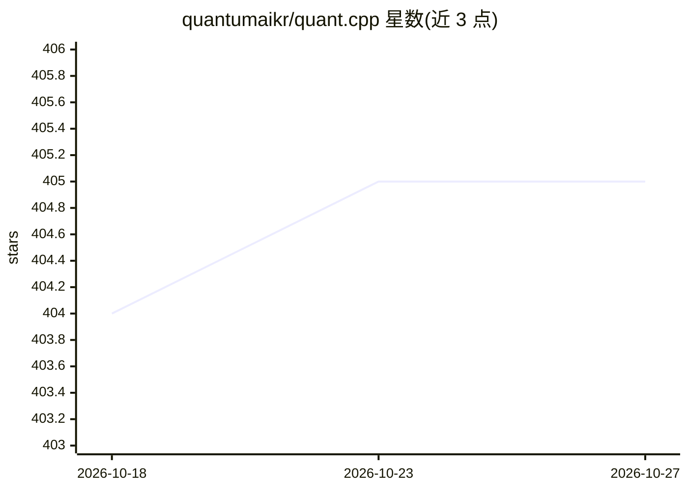

# quantumaikr/quant.cpp

⭐ 405 · C · Apache-2.0 · 推送 2026-04-26 · [GitHub](https://github.com/quantumaikr/quant.cpp) · 组织维护

**纯 C 实现的 LLM 推理库：KV 缓存压缩实现长上下文**

面向开发者的单头文件 C 库（附 Python 包与 CLI），在消费级硬件上本地运行 GGUF 模型：提供 6.4× 有损可控的 KV 缓存压缩（128 token 保留 FP32，其余 4-bit），在 16GB Mac 上以 9.5GB 内存运行 3B 模型 128K 上下文；支持 OpenAI 兼容 serve 接口与流式输出。模型缓存于 ~/.cache，无需 API key 与 GPU。README 附有与 chunk-RAG 的对比基准及 RLV 流水线实验，并披露长文本质量仍会退化的限制。

## 筛选速览

| 维度 | 判定 | 备注 |
|---|---|---|
| AI 角色 | `ai-ecosystem` | LLM/agent 周边工具 |
| 许可风险 | `permissive` | Apache-2.0 |
| 部署形态 | `self-host` | docker 或自建部署 |
| 模型依赖 | — | README 未给出锁定关系 |
| 硬件要求 | — | 无带数字的原话,不猜 |
| 安装摩擦 | `low` | 无编译、无系统依赖或容器化 |
| 成熟度 | `idea` | |

## 能力要点

- 6.4× KV 压缩 + 渐进精度（128 token FP32），宣称 FP32 质量
- 128K 上下文 3B 模型实测 9.5GB 内存（M1 Pro 16GB）
- OpenAI 兼容 /v1/chat/completions 服务与 SSE 流式
- 17.6K 行纯 C，零依赖，pip 安装

## 适用场景

- 在 16GB 内存的 Mac 上加载整篇文档做长上下文推理
- 本地无 GPU、无 API key 运行 Qwen3/Llama 等 GGUF 模型
- 通过 Python API 或 OpenAI 兼容接口嵌入自有应用

## 场景标签

`推理引擎` `模型量化` · 领域:训练与推理

## 证据(README 行号)

> L39: The `serve` subcommand exposes `POST /v1/chat/completions` (OpenAI-compatible) on port 8080 — clients pass `"stream
> L53: Downloads on first use, cached at `~/.cache/quantcpp/`. No API key, no GPU. See `docs/supported_models.md` for the 

## 星数曲线

2026-10-18 404 → 2026-10-27 405（+1）

---
*卡片 v1 · prompt 1.4 · 生成 2026-10-22 · 置信度 mid · 依据 README sha `d3cf1602d54e` · [字段定义](../../DATASET.md)*
