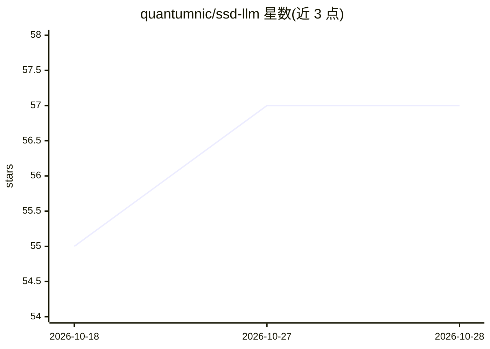

# quantumnic/ssd-llm

⭐ 57 · Rust · MIT · 推送 2026-10-24 · [GitHub](https://github.com/quantumnic/ssd-llm) · 个人维护

**用 SSD 扩展内存、在 Apple Silicon 上运行 70B+ LLM 的推理运行时**

Rust 编写的 LLM 推理运行时，面向统一内存有限的 Mac 用户：不将模型整载入 RAM，而是通过 mmap + madvise 从 SSD 按需流式加载 transformer 层，配合预测预取、LRU 热层驻留与自适应层固定，在 Metal GPU 上计算后释放。支持 GGUF 全系量化格式、投机解码、PagedAttention 式 KV 分页与 SSD 块换出、KV 量化、MoE、多模态（CLIP+LLaVA）、LoRA、GBNF 语法约束等；提供 Ollama/OpenAI 兼容 API 服务器与 /metrics 监控端点。需从源码用 cargo 编译安装。

## 筛选速览

| 维度 | 判定 | 备注 |
|---|---|---|
| AI 角色 | `ai-ecosystem` | LLM/agent 周边工具 |
| 许可风险 | `permissive` | MIT |
| 部署形态 | `None` |  |
| 模型依赖 | local-ok | 支持本地模型 |
| 硬件要求 | — | 无带数字的原话,不猜 |
| 安装摩擦 | `medium` | 含编译或系统依赖之一 |
| 成熟度 | — | 结构信号不足 |

## 能力要点

- 层级流式加载：RAM 中同时仅驻留 1-2 层，madvise 预取与热层 LRU 固定
- Ollama 兼容 API 服务器 + OpenAI 兼容端点（含 /health、/metrics）
- 投机解码、PagedAttention 式分页 KV、SSD 块换出与 KV INT8 量化
- 支持 GGUF K-Quant/I-Quant 全系、LoRA 适配器、GBNF 语法约束、MoE、多模态

## 适用场景

- 在 16-36GB 内存的 MacBook 上运行 70B 级量化模型
- 搭建本地 Ollama/OpenAI 兼容推理服务并接入监控
- 长上下文场景下将 KV cache 溢出到 SSD 以扩展可用上下文

## 场景标签

`推理引擎` · 领域:训练与推理

## 证据(README 行号)

> L16: **ssd-llm** treats your fast Apple SSD as an intelligent extension of RAM:
> L25: Instead of loading the entire model, **ssd-llm** streams transformer layers on-demand from SSD to unified memory, c
> L36: - **🔌 Ollama-compatible API** — Drop-in replacement server with OpenAI-compatible endpoint

## 星数曲线

2026-10-18 55 → 2026-10-28 57（+2）

---
*卡片 v1 · prompt 1.4 · 生成 2026-10-24 · 置信度 high · 依据 README sha `b5c079a5047c` · [字段定义](../../DATASET.md)*
