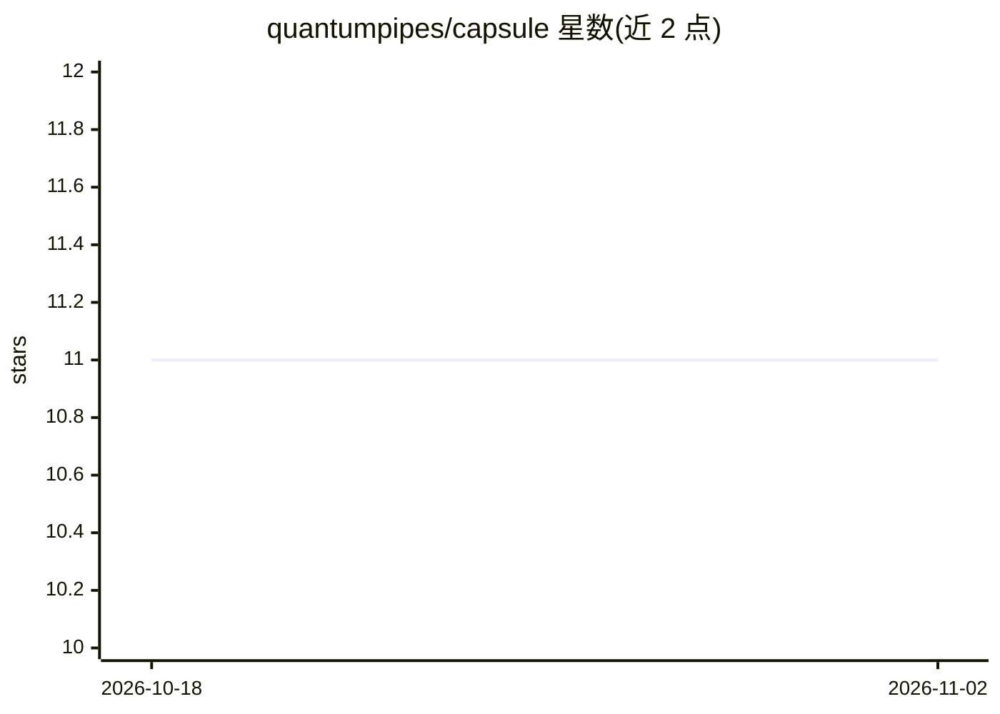

# quantumpipes/capsule

⭐ 11 · Python · Apache-2.0 · 推送 2026-10-26 · [GitHub](https://github.com/quantumpipes/capsule) · [官网](https://quantumpipes.com) · 组织维护

**为自主 AI 操作生成密码学密封审计记录的开放协议**

面向自主 AI 系统的防篡改审计层协议：每个 AI 动作产生一个 Capsule 记录，含六个必填节（含执行前推理捕获），以 SHA3-256 哈希、Ed25519 签名并链接成哈希链，可通过 capsule:// URI 内容寻址。规范语言无关，提供 Python/TypeScript 参考实现（pip/npm 安装）、Go 验证库、LiteLLM 自动审计集成及 CLI，用 16 个金标准测试向量保证跨实现互操作。协议级映射 11 个监管框架（NIST、EU AI Act 等），支持离线运行与可选 ML-DSA-65 后量子签名。

## 筛选速览

| 维度 | 判定 | 备注 |
|---|---|---|
| AI 角色 | `ai-ecosystem` | LLM/agent 周边工具 |
| 许可风险 | `permissive` | Apache-2.0 |
| 部署形态 | `library` | 以包/库形式分发 |
| 模型依赖 | — | README 未给出锁定关系 |
| 硬件要求 | — | 无带数字的原话,不猜 |
| 安装摩擦 | `low` | 无编译、无系统依赖或容器化 |
| 成熟度 | — | 结构信号不足 |

## 能力要点

- 六节记录结构，执行前捕获 AI 推理过程
- SHA3-256 + Ed25519 签名与哈希链，篡改可检测
- capsule:// URI 内容寻址，无需注册中心即可验证
- Python/TypeScript 参考实现、Go 验证库与 LiteLLM 自动审计集成

## 适用场景

- 为 AI agent 的自主决策与工具调用建立合规审计证据
- 在 CI/CD 流水线中用 capsule verify 作为部署门禁
- 应对监管审查时提供带时间戳的执行前推理记录

## 场景标签

 · 领域:AI 治理/审计基础设施

## 证据(README 行号)

> L3: **The cryptographically signed memory layer for autonomous AI.**
> L5: Every AI action produces a Capsule — a tamper-evident, content-addressable record of what happened, why it happened,
> L36: AI systems make thousands of autonomous decisions. When something goes wrong — or when a regulator asks "why did th

## 星数曲线

2026-10-18 11 → 2026-11-02 11（+0）

---
*卡片 v1 · prompt 1.4 · 生成 2026-11-01 · 置信度 high · 依据 README sha `f1f9ab9d762e` · [字段定义](../../DATASET.md)*
