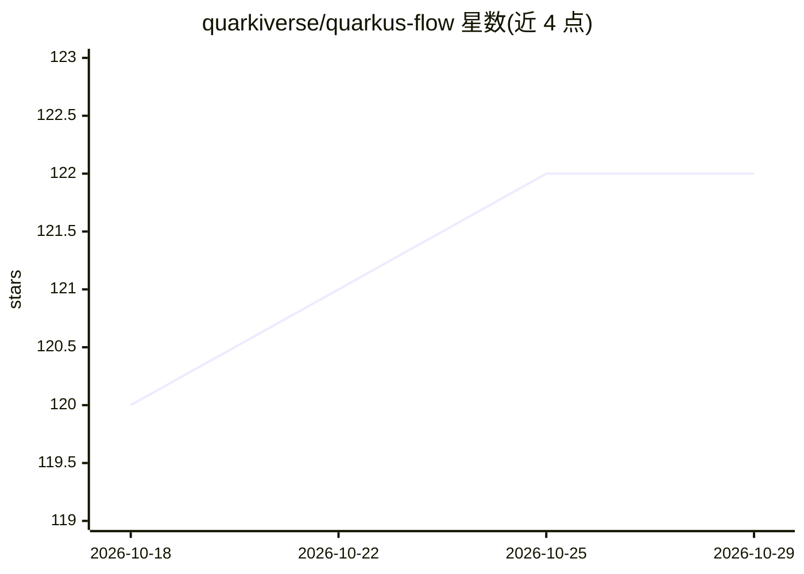

# quarkiverse/quarkus-flow

⭐ 122 · Java · Apache-2.0 · 推送 2026-10-28 · [GitHub](https://github.com/quarkiverse/quarkus-flow) · [官网](https://docs.quarkiverse.io/quarkus-flow/dev) · 组织维护

**面向 Quarkus 的 Agentic AI 工作流运行时引擎**

基于 Open Workflow Specification（CNCF 沙箱项目）的 Quarkus 扩展，用于建模经典工作流与 Agentic AI 编排。提供流式 Java DSL 与 YAML/JSON 定义，通过构建期 CDI 发现注入工作流；支持 LangChain4j agent 作为工作流任务编排（三种方式：Java DSL 任务、注解生成工作流、混合模式）。模块覆盖持久化（JPA/MVStore/Infinispan）、Kafka/AMQP 消息、调度、Kubernetes 协调等，核心模块标记 Stable，LangChain4j 集成等标记 Preview（向后兼容不保证），run.shell/container/script 任务声明不支持生产使用。要求 Quarkus 3.39.0+ 与 JDK 17/21/25。面向 Quarkus/Java 开发者，以 Maven 依赖引入，另提供预构建 Docker runner 供探索。

## 筛选速览

| 维度 | 判定 | 备注 |
|---|---|---|
| AI 角色 | `ai-ecosystem` | LLM/agent 周边工具 |
| 许可风险 | `permissive` | Apache-2.0 |
| 部署形态 | `self-host` | docker 或自建部署 |
| 模型依赖 | — | README 未给出锁定关系 |
| 硬件要求 | — | 无带数字的原话,不猜 |
| 安装摩擦 | `low` | 无编译、无系统依赖或容器化 |
| 成熟度 | `idea` | |

## 能力要点

- 基于 Open Workflow Specification 的 Java DSL 与 YAML/JSON 工作流定义
- 三种方式编排 LangChain4j agent：Java DSL 任务、注解生成工作流、混合模式
- 多种持久化后端（JPA/MVStore/Infinispan）与 Kafka/AMQP 消息集成
- 预构建 Docker runner 可免编码探索工作流功能

## 适用场景

- 在 Quarkus 应用中编排包含 AI agent 的长运行业务流程
- 用注解声明 agentic 工作流模式（顺序/并行/循环/条件）并自动注册
- 混合编排 AI 任务与 HTTP、消息、定时器、human-in-the-loop 任务

## 场景标签

`工作流自动化` `Agent 框架` · 领域:Agent 开发

## 证据(README 行号)

> L11: **Quarkus Flow** is a lightweight, low-dependency, production-grade workflow engine for Quarkus, built on the Open 
> L27: * 🤝 **Agentic AI ready**: orchestrate LangChain4j agents as workflow **tasks** (with loops + human-in-the-loop)
> L147: ## LangChain4j Integration (Agentic AI Workflows)

## 星数曲线

2026-10-18 120 → 2026-10-29 122（+2）

---
*卡片 v1 · prompt 1.4 · 生成 2026-10-23 · 置信度 high · 依据 README sha `e37c0489fb7f` · [字段定义](../../DATASET.md)*
