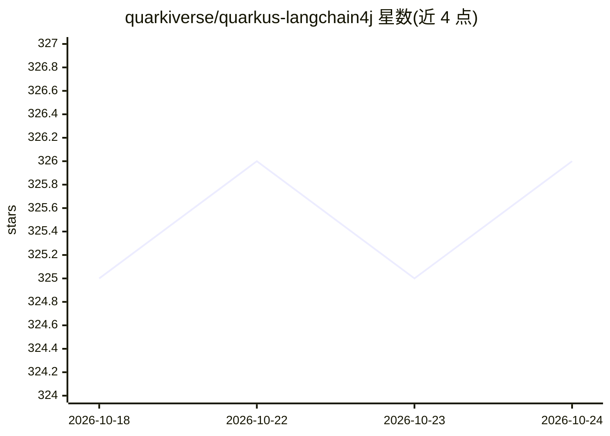

# quarkiverse/quarkus-langchain4j

⭐ 326 · Java · Apache-2.0 · 推送 2026-10-24 · [GitHub](https://github.com/quarkiverse/quarkus-langchain4j) · [官网](https://docs.quarkiverse.io/quarkus-langchain4j/dev/index.html) · 组织维护

**Quarkus 框架的 LangChain4j 扩展，帮助 Java 应用接入 LLM**

由 Quarkiverse 维护的 Quarkus 扩展集合，将 LangChain4j 集成到 Quarkus 应用中，使 Java 开发者能在 Quarkus 项目内使用大语言模型。支持声明式 AI 服务、工具调用、嵌入、文档存储集成（Redis/Chroma/Infinispan 等）、原生编译（native image）以及 Quarkus 可观测栈（指标、追踪）集成。接入方式为添加 Maven 依赖，可对接 OpenAI GPT、Hugging Face、Ollama 等多种模型提供方。

## 筛选速览

| 维度 | 判定 | 备注 |
|---|---|---|
| AI 角色 | `ai-ecosystem` | LLM/agent 周边工具 |
| 许可风险 | `permissive` | Apache-2.0 |
| 部署形态 | `None` |  |
| 模型依赖 | local-ok | 支持本地模型 |
| 硬件要求 | — | 无带数字的原话,不猜 |
| 安装摩擦 | `low` | 无编译、无系统依赖或容器化 |
| 成熟度 | — | 结构信号不足 |

## 能力要点

- 声明式 AI 服务与工具（Tool）支持
- 对接多种 LLM（OpenAI GPT、Hugging Face、Ollama 等）
- 文档存储集成（Redis、Chroma、Infinispan 等）
- 原生编译支持与 Quarkus 可观测栈集成

## 适用场景

- 在 Quarkus Java 应用中接入 LLM 构建对话或生成功能
- 用声明式方式定义 AI 服务并配合工具调用
- 结合企业 Java 技术栈做 RAG（嵌入+文档存储）

## 场景标签

`RAG` `Agent 框架` · 领域:Agent 开发

## 证据(README 行号)

> L6: This repository contains Quarkus extensions that facilitate seamless integration between Quarkus and LangChain4j, en
> L12: - Declarative AI services

## 星数曲线

2026-10-18 325 → 2026-10-24 326（+1）

---
*卡片 v1 · prompt 1.4 · 生成 2026-10-21 · 置信度 high · 依据 README sha `b5f06c68289f` · [字段定义](../../DATASET.md)*
