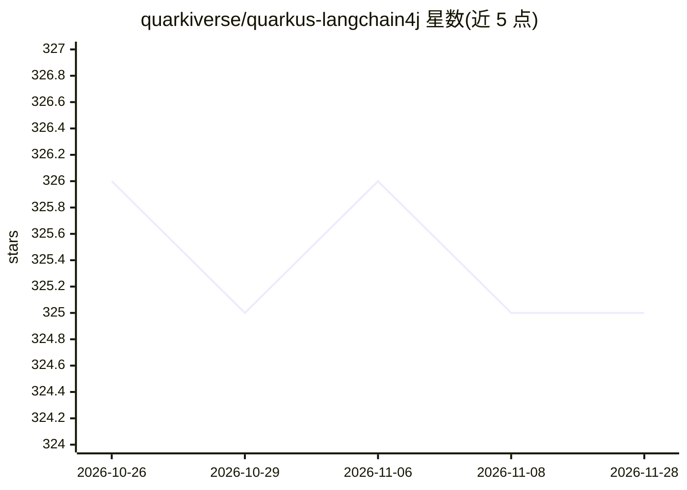

# quarkiverse/quarkus-langchain4j

⭐ 325 · Java · Apache-2.0 · 推送 2026-11-27 · [GitHub](https://github.com/quarkiverse/quarkus-langchain4j) · [官网](https://docs.quarkiverse.io/quarkus-langchain4j/dev/index.html) · 组织维护

**面向 Quarkus 开发者的 LangChain4j 集成扩展**

该项目提供一组 Quarkus 扩展，将 LangChain4j 与 Quarkus 应用集成，支持声明式 AI 服务、多种 LLM 接入（OpenAI、Hugging Face、Ollama 等）、工具调用、嵌入、文档存储（Redis、Chroma、Infinispan 等）、GraalVM 原生编译以及与 Quarkus 可观测性栈和可插拔认证提供方的整合。面向使用 Java/Quarkus 构建应用的开发者，通过添加 Maven 依赖即可使用，当前版本为 2.0.0.CR1。

## 筛选速览

| 维度 | 判定 | 备注 |
|---|---|---|
| AI 角色 | `ai-ecosystem` | LLM/agent 周边工具 |
| 许可风险 | `permissive` | Apache-2.0 |
| 部署形态 | `None` |  |
| 模型依赖 | local-ok | 支持本地模型 |
| 硬件要求 | — | 无带数字的原话,不猜 |
| 安装摩擦 | `low` | 无编译、无系统依赖或容器化 |
| 成熟度 | — | 结构信号不足 |

## 能力要点

- 声明式 AI 服务与工具/嵌入支持
- 接入多种 LLM：OpenAI、Hugging Face、Ollama 等
- 文档存储集成（Redis、Chroma、Infinispan）
- 支持原生编译与 Quarkus 可观测性栈

## 适用场景

- 在 Quarkus Java 应用中集成 LLM 能力
- 用声明式方式构建带工具调用的 AI 服务
- 将嵌入与向量文档存储接入 Quarkus 项目

## 场景标签

`Agent 框架` `RAG` · 领域:Agent 开发

## 证据(README 行号)

> L6: This repository contains Quarkus extensions that facilitate seamless integration between Quarkus and LangChain4j, en
> L12: - Declarative AI services

## 星数曲线

2026-10-26 326 → 2026-11-28 325（-1）

---
*卡片 v1 · prompt 1.4 · 生成 2026-11-25 · 置信度 high · 依据 README sha `f64e8714f275` · [字段定义](../../DATASET.md)*
