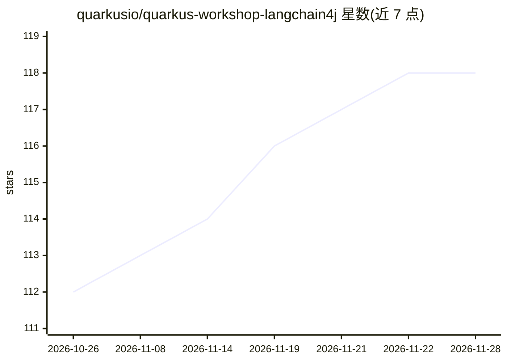

# quarkusio/quarkus-workshop-langchain4j

⭐ 118 · Java · Apache-2.0 · 推送 2026-11-27 · [GitHub](https://github.com/quarkusio/quarkus-workshop-langchain4j) · [官网](http://quarkus.io/quarkus-workshop-langchain4j/) · 组织维护

**Java 开发者学习用 Quarkus+LangChain4j 构建 AI 应用的工作坊教程**

Quarkus 官方 LangChain4j 工作坊教程：通过分步骤的练习，教 Java 开发者使用 Quarkus 框架与 LangChain4j 构建 AI 应用，覆盖单 AI 服务与 Agentic AI 编排两类内容。README 提供教程网站链接，也可按 docs/README 在本地部署文档；每个步骤的完成状态存放在 step-XX 目录中，进入目录后用 ./mvnw quarkus:dev 启动，应用运行在 localhost:8080。

## 筛选速览

| 维度 | 判定 | 备注 |
|---|---|---|
| AI 角色 | `ai-knowledge` | 知识聚合/清单类 |
| 许可风险 | `permissive` | Apache-2.0 |
| 部署形态 | `None` |  |
| 模型依赖 | — | README 未给出锁定关系 |
| 硬件要求 | — | 无带数字的原话,不猜 |
| 安装摩擦 | `low` | 无编译、无系统依赖或容器化 |
| 成熟度 | — | 结构信号不足 |

## 能力要点

- 分步骤教学，每步最终代码存于 step-XX 目录
- 覆盖单 AI 服务与 Agentic AI 编排
- 教程网站提供完整指引，也可本地服务文档

## 适用场景

- Java 开发者学习 Quarkus 与 LangChain4j 集成
- 了解用 Java 构建 Agentic AI 编排系统
-  workshops/培训课程材料使用

## 场景标签

`教程课程` · 领域:学习与行业

## 证据(README 行号)

> L1: # Building Agentic AI Systems with Java: Quarkus LangChain4j Workshop
> L3: A workshop to learn how to build AI-Infused applications with Quarkus and LangChain4j.

## 星数曲线

2026-10-26 112 → 2026-11-28 118（+6）

---
*卡片 v1 · prompt 1.4 · 生成 2026-11-28 · 置信度 high · 依据 README sha `b2006fd32e01` · [字段定义](../../DATASET.md)*
