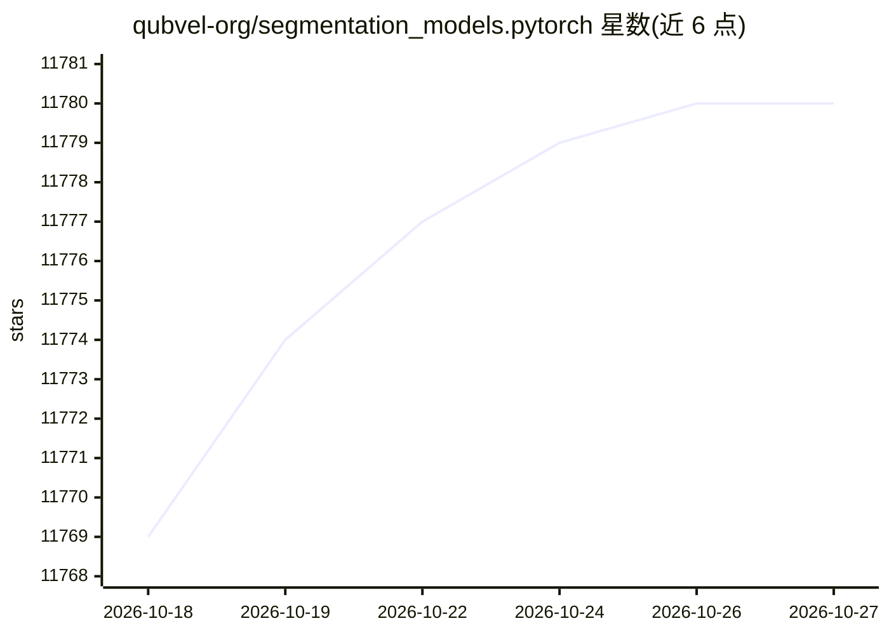

# qubvel-org/segmentation_models.pytorch

⭐ 11,780 · Python · MIT · 推送 2026-10-26 · [GitHub](https://github.com/qubvel-org/segmentation_models.pytorch) · [官网](https://smp.readthedocs.io/) · 组织维护

**PyTorch 图像语义分割模型库：12 种架构与 800+ 预训练编码器**

基于 PyTorch 的 Python 图像语义分割库：提供 Unet、Unet++、DeepLabV3+、Segformer、DPT 等 12 种编码器-解码器架构，可搭配 800 余个预训练卷积与 transformer 编码器（含 timm 支持），两行代码即可创建模型；内置 Dice、Jaccard 等损失与指标，支持 ONNX 导出、torch script/trace/compile，以及 HuggingFace Hub 模型保存加载。面向计算机视觉开发者，用于训练与推理语义分割模型。部分文件受其他许可约束，商用前需检查 LICENSES。

## 筛选速览

| 维度 | 判定 | 备注 |
|---|---|---|
| AI 角色 | `ai-native` | 本体是模型或模型工具 |
| 许可风险 | `permissive` | MIT |
| 部署形态 | `library` | 以包/库形式分发 |
| 模型依赖 | — | README 未给出锁定关系 |
| 硬件要求 | — | 无带数字的原话,不猜 |
| 安装摩擦 | `medium` | 含编译或系统依赖之一 |
| 成熟度 | — | 结构信号不足 |

## 能力要点

- 12 种分割架构（Unet/Unet++/Segformer/DPT 等）
- 800+ 预训练编码器，含 timm 支持
- 内置 Dice/Jaccard/Tversky 等常用损失与指标
- 支持 ONNX 导出与 torch script/trace/compile

## 适用场景

- 为我的视觉项目快速搭建并训练语义分割模型
- 加载预训练 Segformer/DPT 直接做分割推理
- 竞赛或工业任务中按需选择轻量或高精度编码器

## 场景标签

`目标检测` · 领域:感知与多模态

## 证据(README 行号)

> L2: **Python library with Neural Networks for Image Semantic
> L3: Segmentation based on PyTorch.**
> L20:  - 800+ **pretrained** convolution- and transform-based encoders, including timm support

## 星数曲线

2026-10-18 11,769 → 2026-10-27 11,780（+11）

---
*卡片 v1 · prompt 1.4 · 生成 2026-10-20 · 置信度 high · 依据 README sha `863e43025c79` · [字段定义](../../DATASET.md)*
