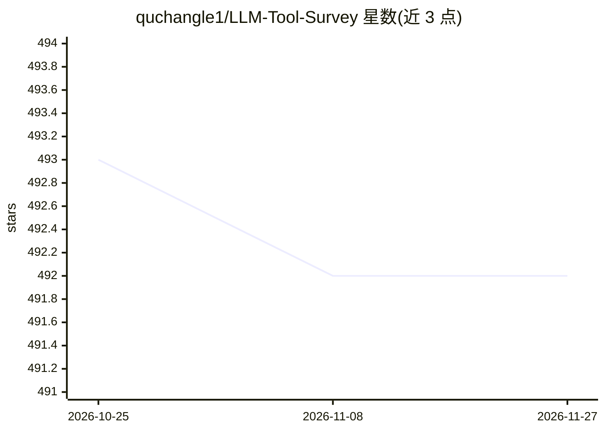

# quchangle1/LLM-Tool-Survey

⭐ 492 · 推送 2026-10-27 · [GitHub](https://github.com/quchangle1/LLM-Tool-Survey) · [官网](https://arxiv.org/abs/2405.17935) · 组织维护 · 中文 README

**LLM 工具学习论文清单：配合同名综述梳理领域文献**

论文《Tool Learning with Large Language Models: A Survey》的配套论文集，收录工具学习相关文献并按综述的分类组织：先从工具收益（知识获取、专家能力增强、自动化效率）说明

## 筛选速览

| 维度 | 判定 | 备注 |
|---|---|---|
| AI 角色 | `ai-knowledge` | 知识聚合/清单类 |
| 许可风险 | `none` | — |
| 部署形态 | `None` |  |
| 模型依赖 | — | README 未给出锁定关系 |
| 硬件要求 | — | 无带数字的原话,不猜 |
| 安装摩擦 | `low` | 无编译、无系统依赖或容器化 |
| 成熟度 | — | 结构信号不足 |

## 能力要点

- 按综述四阶段工作流（任务规划/工具选择/工具调用/响应生成）组织文献
- 每条论文附 arXiv 链接
- 综述被 Frontiers of Computer Science 接收
- 提供引用 BibTeX 与社区贡献入口

## 适用场景

- 调研 LLM 工具学习方向时按分类查找相关论文
- 新人进入该领域前做文献梳理
- 综述写作时引用配套论文清单

## 场景标签

`精选清单` · 领域:学习与行业

## 证据(README 行号)

> L5: This is the collection of papers related to tool learning with LLMs. These papers are organized according to our sur
> L9: :tada: Our survey paper is accepted by **Frontiers of Computer Science (FCS)**. The latest version of our paper has 

## 星数曲线

2026-10-25 493 → 2026-11-27 492（-1）

---
*卡片 v1 · prompt 1.4 · 生成 2026-11-25 · 置信度 high · 依据 README sha `c69b5dcd2074` · [字段定义](../../DATASET.md)*
