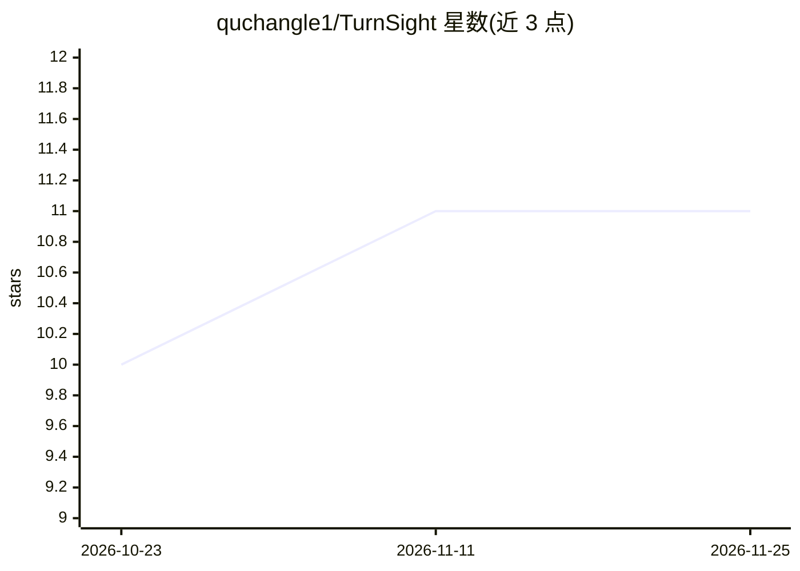

# quchangle1/TurnSight

⭐ 11 · Python · 推送 2026-08-05 · [GitHub](https://github.com/quchangle1/TurnSight) · 个人维护

**工具集成推理训练方法的论文官方实现与模型发布**

论文《TurnSight: Turn-Level Hindsight Self-Distillation for Tool-Integrated Reasoning》的官方代码库：提供多轮工具集成推理训练的完整流程，包含四阶段机制（多轮 TIR 基础优势、执行后见教师视角、多前瞻教师选择、组归一化加权）。基于 Qwen3-4B/8B 检查点，训练代码为 VeRL 框架扩展，依赖 Ray Jobs 服务器，发布模型检查点与数据集于 Hugging Face，并给出 FTRL/BFCL/ToolHop 三个基准的评测脚本。

## 筛选速览

| 维度 | 判定 | 备注 |
|---|---|---|
| AI 角色 | `ai-knowledge` | 知识聚合/清单类 |
| 许可风险 | `none` | — |
| 部署形态 | `library` | 以包/库形式分发 |
| 模型依赖 | — | README 未给出锁定关系 |
| 硬件要求 | — | 无带数字的原话,不猜 |
| 安装摩擦 | `low` | 无编译、无系统依赖或容器化 |
| 成熟度 | — | 结构信号不足 |

## 能力要点

- 多轮工具集成推理训练：turn 级优势 + 教师自蒸馏
- 发布 Qwen3-4B/8B 两个模型检查点及训练/测试数据集
- 训练基于 VeRL 框架扩展，通过 Ray Jobs 启动
- 提供 FTRL、ToolHop 评测脚本，BFCL 用官方代码评测

## 适用场景

- 复现论文的训练与实验流程
- 在自己的多轮工具调用数据上运行该训练方法
- 下载检查点在工具集成推理基准上做评测

## 场景标签

`强化学习` `模型评测` · 领域:评测与运维

## 证据(README 行号)

> L1: 🛠️👀 TurnSight: Turn-Level Hindsight Self-Distillation for
> L56: ├── Code/                 # VeRL extensions and TurnSight training code
> L134: This project uses the VeRL framework for distributed reinforcement learning and tool-integrated reasoning.

## 星数曲线

2026-10-23 10 → 2026-11-25 11（+1）

---
*卡片 v1 · prompt 1.4 · 生成 2026-11-18 · 置信度 high · 依据 README sha `fd8dd011f9d5` · [字段定义](../../DATASET.md)*
