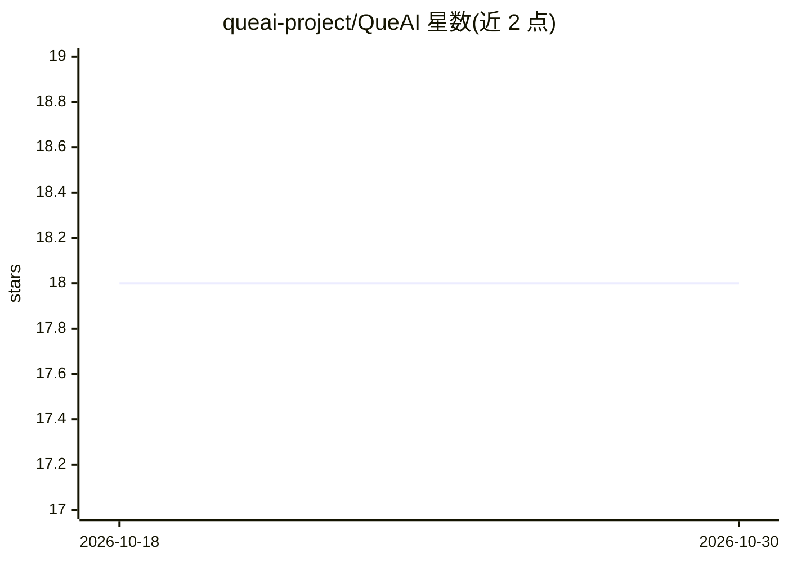

# queai-project/QueAI

⭐ 18 · Python · MIT · 推送 2026-06-13 · [GitHub](https://github.com/queai-project/QueAI) · [官网](https://queai.dev) · 个人维护

**模块化 AI 编排运行时：以 Docker 插件统一管理本地模型与云端 API**

开源的 AI 能力编排内核：每个 AI 能力封装为带独立 UI 与 REST API 的 Docker 容器插件，可以是本地 CPU 模型或 OpenAI/Anthropic/ElevenLabs 等公共 API 的代理。内核由 Traefik 路由、Django 后端与 hub UI 组成，提供统一仪表盘（/manager）、REST API（/api/v1）、queai CLI，负责模块发现、安装、启停、监控与审计，并内置强制认证、审计日志与 CLI 备份恢复。面向自托管部署者，通过 curl 一行脚本或 docker compose 手动安装，插件可用任意 HTTP 服务实现。

## 筛选速览

| 维度 | 判定 | 备注 |
|---|---|---|
| AI 角色 | `ai-ecosystem` | LLM/agent 周边工具 |
| 许可风险 | `permissive` | MIT |
| 部署形态 | `self-host` | docker 或自建部署 |
| 模型依赖 | — | README 未给出锁定关系 |
| 硬件要求 | — | 无带数字的原话,不猜 |
| 安装摩擦 | `low` | 无编译、无系统依赖或容器化 |
| 成熟度 | — | 结构信号不足 |

## 能力要点

- 每个 AI 能力为独立 Docker 插件容器，本地模型与公共 API 代理同一契约
- Traefik + Django 内核统一路由/监控/审计，提供 hub UI、REST API 与 queai CLI
- 强制认证、审计日志、健康检查与 CLI 备份恢复
- 安装器可检测并复用已有 Docker 环境（非破坏式，支持 dry-run）

## 适用场景

- 自托管统一管理多个本地模型与云端 API 插件
- 通过一个仪表盘启停、配置和监控多个 AI 模块
- 在脚本或 CI 中用 queai CLI 自动化模块操作

## 场景标签

`模型网关` · 领域:Agent 开发

## 证据(README 行号)

> L5: QueAI is an open-source runtime for AI capabilities. Each capability is a
> L17: |Every AI capability ships its own server, its own `.env`, its own port|The kernel discovers, installs and orchestr
> L32: Flow: client → Traefik → Django (`/manager`, `/marketplace`, `/monitor`, `/api/v1`) → Docker operations → modules.

## 星数曲线

2026-10-18 18 → 2026-10-30 18（+0）

---
*卡片 v1 · prompt 1.4 · 生成 2026-10-29 · 置信度 high · 依据 README sha `c22d5e997265` · [字段定义](../../DATASET.md)*
