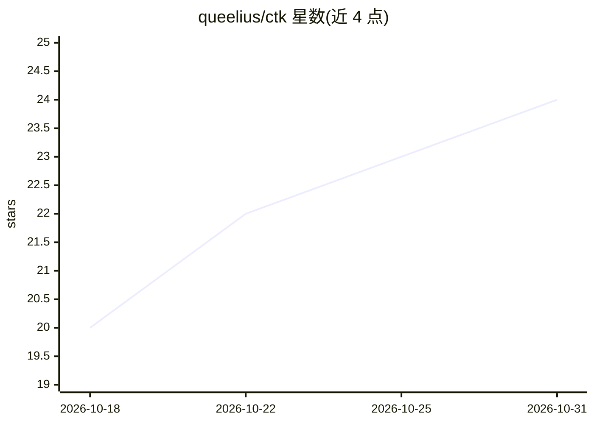

# queelius/ctk

⭐ 24 · Python · MIT · 推送 2026-10-25 · [GitHub](https://github.com/queelius/ctk) · [官网](https://queelius.github.io/ctk/) · 个人维护

**多平台 AI 对话记录统一管理 CLI/TUI：导入、搜索、分支、导出与对话**

面向使用多个 LLM 服务用户的对话管理工具：把 ChatGPT、Claude、Gemini、Copilot、Claude Code 等来源的对话导出导入本地 SQLite+FTS5 数据库，以统一树形结构存储（线性对话为单路径树，保留再生成分支），提供全屏 Textual TUI 与可脚本化 CLI 子命令完成搜索、分支、嫁接、合并、导出（JSONL/Markdown/HTML/Hugo）。LLM 后端通过 OpenAI 兼容协议支持 OpenAI、Azure、OpenRouter、vLLM、llama.cpp、LM Studio、Ollama 等命名配置切换，支持 MCP 工具调用并可作为 MCP server 运行。以 git clone 源码安装为主，pip 发布标注为尚未上线。

## 筛选速览

| 维度 | 判定 | 备注 |
|---|---|---|
| AI 角色 | `ai-ecosystem` | LLM/agent 周边工具 |
| 许可风险 | `permissive` | MIT |
| 部署形态 | `library` | 以包/库形式分发 |
| 模型依赖 | local-ok | 支持本地模型 |
| 硬件要求 | — | 无带数字的原话,不猜 |
| 安装摩擦 | `medium` | 含编译或系统依赖之一 |
| 成熟度 | — | 结构信号不足 |

## 能力要点

- 统一树形对话模型，六个树原语组合出 fork/branch/clone/snapshot 等操作
- 多来源导入（ChatGPT/Claude/Gemini/Copilot/文件系统编码代理）与多格式导出（JSONL/Markdown/HTML/Hugo）
- OpenAI 兼容后端命名配置，TUI 内 /provider 实时切换，含本地 vLLM/llama.cpp/LM Studio/Ollama
- ctk 既做 MCP 客户端（工具调用）也可作为 MCP server 运行

## 适用场景

- 把散落在 ChatGPT、Claude、Gemini 等平台的对话历史集中到本地统一管理
- 在分支树上探索不同回复路径，fork/嫁接重组对话上下文
- 把清洗后的对话导出为 JSONL 微调数据集（含 --sanitize 脱敏）

## 场景标签

`聊天机器人` `Agent 记忆` · 领域:Agent 开发

## 证据(README 行号)

> L3: A plugin-based system for managing AI conversations from multiple providers. Import, store, search, branch, and expo
> L21: - **Multiple LLM Backends**: named provider profiles for OpenAI, Azure, OpenRouter, vLLM, llama.cpp, LM Studio, Oll
> L205: CTK ships one provider implementation, `OpenAIProvider`, wrapping the official `openai` SDK. It speaks the OpenAI 

## 星数曲线

2026-10-18 20 → 2026-10-31 24（+4）

---
*卡片 v1 · prompt 1.4 · 生成 2026-10-27 · 置信度 mid · 依据 README sha `7a49398fd7aa` · [字段定义](../../DATASET.md)*
