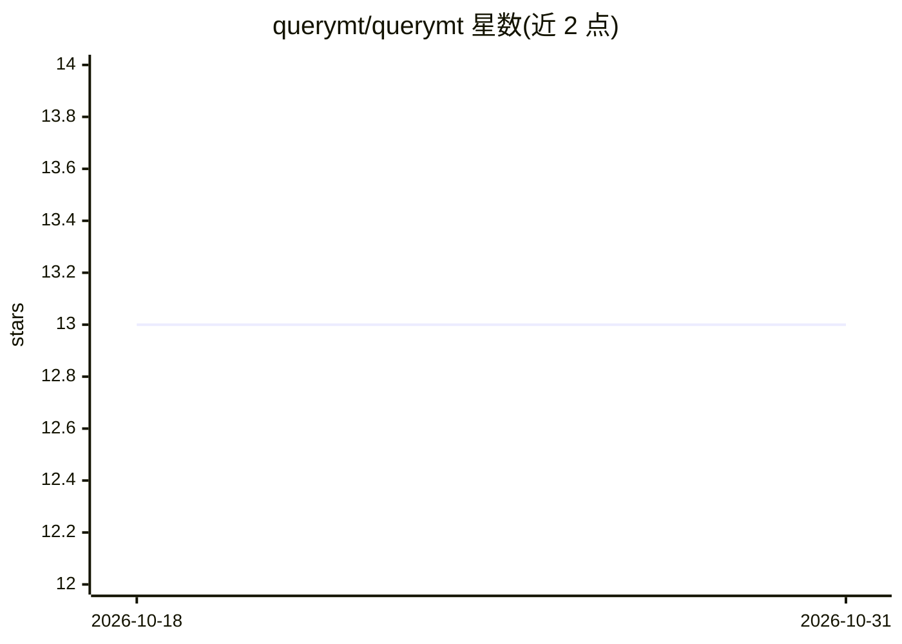

# querymt/querymt

⭐ 13 · Rust · MIT · 推送 2026-10-30 · [GitHub](https://github.com/querymt/querymt) · [官网](https://query.mt) · 组织维护

**面向开发者的统一 LLM 接口框架与插件式 provider 架构**

QueryMaTe 是以 Rust 编写的 LLM 统一接口库与 agent 运行时：通过基于插件的架构（含 WASM/Extism 加载器）接入多种 LLM provider，以 providers.toml 配置。核心 crate querymt 提供 LLMBuilder/ChatMessage 等构建 API，querymt-agent 是高层 agent 运行时，支持 ACP stdio/WebSocket、API（含 SFT 导出）、内嵌 Svelte dashboard 四种互斥传输模式。安装方式为安装脚本（curl/PowerShell）或 Cargo 依赖引入；dashboard 源码构建需 Node.js 与 npm，macOS Silicon 发布版需清除 quarantine 标记。

## 筛选速览

| 维度 | 判定 | 备注 |
|---|---|---|
| AI 角色 | `ai-ecosystem` | LLM/agent 周边工具 |
| 许可风险 | `permissive` | MIT |
| 部署形态 | `None` |  |
| 模型依赖 | — | README 未给出锁定关系 |
| 硬件要求 | — | 无带数字的原话,不猜 |
| 安装摩擦 | `low` | 无编译、无系统依赖或容器化 |
| 成熟度 | — | 结构信号不足 |

## 能力要点

- 插件式架构统一多种 LLM provider 接口（Extism/WASM 加载）
- querymt-agent 高层 agent 运行时，TOML 配置加载
- 四种传输模式：ACP stdio、ACP WebSocket、API（含 SFT 导出）、内嵌 dashboard

## 适用场景

- 在 Rust 项目中用统一 API 调用不同 LLM provider
- 以 ACP 协议接入工具链运行 agent
- 通过内嵌 dashboard 与 agent 交互并导出 SFT 数据

## 场景标签

`模型网关` `Agent 框架` · 领域:Agent 开发

## 证据(README 行号)

> L7: A unified interface for Large Language Models (LLMs) with support for various providers via a plugin-based architect
> L63: The `querymt-agent` crate (in `crates/agent`) is the high-level agent runtime for QueryMaTe.

## 星数曲线

2026-10-18 13 → 2026-10-31 13（+0）

---
*卡片 v1 · prompt 1.4 · 生成 2026-10-31 · 置信度 high · 依据 README sha `d747c4fb7a36` · [字段定义](../../DATASET.md)*
