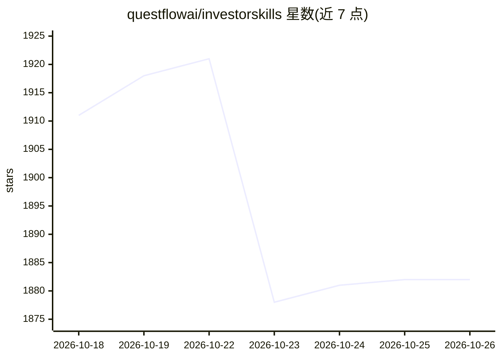

# questflowai/investorskills

⭐ 1,882 · Swift · MIT · 推送 2026-08-23 · [GitHub](https://github.com/questflowai/investorskills) · [官网](https://questflow.ai) · 组织维护

**历史著名投资者判断体系的开源技能包库，供 AI 金融 agent 调用**

将巴菲特、芒格、索罗斯、西蒙斯等数十位投资者的判断体系（信号、过滤器、仓位、风险、监控、行动手册）结构化为 SKILL.md + invest.md 的纯文本技能包，供 AI 金融 agent 或人类学习使用。技能可在 Questflow 金融 harness 内运行，也可在 Claude Code、Codex、Cursor 等任何能读取 SKILL.md 的 agent 框架中使用，或直接复制进对话。配套模板、投资 schema 规范、阅读/播客/YouTube 清单；另有 Questflow 付费会员专属闭源技能不在本仓库发布。

## 筛选速览

| 维度 | 判定 | 备注 |
|---|---|---|
| AI 角色 | `ai-knowledge` | 知识聚合/清单类 |
| 许可风险 | `permissive` | MIT |
| 部署形态 | `library` | 以包/库形式分发 |
| 模型依赖 | — | README 未给出锁定关系 |
| 硬件要求 | — | 无带数字的原话,不猜 |
| 安装摩擦 | `low` | 无编译、无系统依赖或容器化 |
| 成熟度 | — | 结构信号不足 |

## 能力要点

- 38 个投资者技能包，覆盖价值、成长、宏观、做空、量化等风格
- SKILL.md 为 agent 入口，invest.md 用 YAML+Markdown 结构化判断系统
- 提供模板与 schema 规范，可自建新投资者技能
- 配套各技能的阅读清单、播客与视频索引

## 适用场景

- 给 Claude Code、Codex、Cursor 等 agent 装载投资者判断技能
- 学习并对照研究不同投资大师的决策体系
- 在 Questflow 中结合行情与组合上下文运行这些技能
- 基于模板为自己的投资框架创建结构化技能包

## 场景标签

`金融量化` `教程课程` · 领域:学习与行业

## 证据(README 行号)

> L14: Investor Skills is an open-source library that turns durable investing judgment into portable, structured formats. 
> L20: Investor Skills are plain-text skill packages. You can use them in Claude Code, Codex, Cursor, OpenCode, or any oth

## 星数曲线

2026-10-18 1,911 → 2026-10-26 1,882（-29）

---
*卡片 v1 · prompt 1.4 · 生成 2026-10-21 · 置信度 high · 依据 README sha `d9c9f9e3a776` · [字段定义](../../DATASET.md)*
