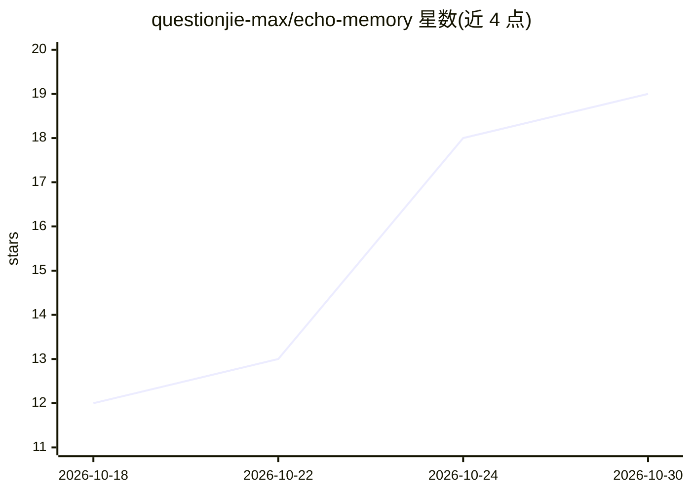

# questionjie-max/echo-memory

⭐ 19 · Rust · Apache-2.0 · 推送 2026-10-25 · [GitHub](https://github.com/questionjie-max/echo-memory) · [官网](https://github.com/questionjie-max/echo-memory/releases/latest) · 个人维护 · 中文 README

**macOS 本地个人记忆库：把录音、文档与 AI 对话转为可复用记忆**

面向个人用户的本地优先 macOS 应用：采集应用内录音、音频文件、Markdown/TXT/DOCX 文档、ChatGPT/Claude 导出及 Claude Code/Codex 本地会话，统一进入 SQLite 本地库。转录用嵌入式 Whisper 或本地 whisper.cpp，分析用本地 Ollama 模型（可选经单独授权接入 OpenAI 兼容云服务），结论逐字比对转录稿、不匹配即丢弃，可回溯时间戳证据；跨记录记忆版本化并需用户确认后，经默认关闭、只读的本地 stdio MCP 服务器暴露给授权 AI 工具。无 Windows/移动端、无云同步、不录系统输出音频。

## 筛选速览

| 维度 | 判定 | 备注 |
|---|---|---|
| AI 角色 | `ai-native` | 本体是模型或模型工具 |
| 许可风险 | `permissive` | Apache-2.0 |
| 部署形态 | `desktop` | 安装包/桌面程序 |
| 模型依赖 | local-ok | 支持本地模型 |
| 硬件要求 | — | 无带数字的原话,不猜 |
| 安装摩擦 | `medium` | 含编译或系统依赖之一 |
| 成熟度 | — | 结构信号不足 |

## 能力要点

- 录音/文档/AI 对话三类来源统一入库，本地 Whisper + Ollama 完成转录与分析
- 结论逐字比对转录稿、不匹配即丢弃，全部证据可回溯原文与时间戳
- 记忆版本化、需用户确认后经只读本地 MCP 暴露（get_my_context 等工具）
- API key 存 macOS Keychain，第三方上传需服务层强制的独立授权

## 适用场景

- 把会议、访谈、语音备忘录整理成可检索、可溯源的个人知识库
- 让 Claude Code 等 AI 工具通过 MCP 读取我已确认的个人上下文
- 将 ChatGPT/Claude 对话导出归档为可检索、可问答的记录

## 场景标签

`知识库管理` `Agent 记忆` `文档问答` · 领域:Agent 开发

## 证据(README 行号)

> L17: Transcription and analysis run entirely on your machine (Whisper + Ollama — no cloud, no per-minute caps), every co
> L82: - Uses local Ollama models for summaries, key points, decisions, action items, and open questions. A per-record sup
> L146: The current MCP server is local stdio, disabled by default, and read-only. It can search records, retrieve bounded

## 星数曲线

2026-10-18 12 → 2026-10-30 19（+7）

---
*卡片 v1 · prompt 1.4 · 生成 2026-10-29 · 置信度 mid · 依据 README sha `201d0552427d` · [字段定义](../../DATASET.md)*
