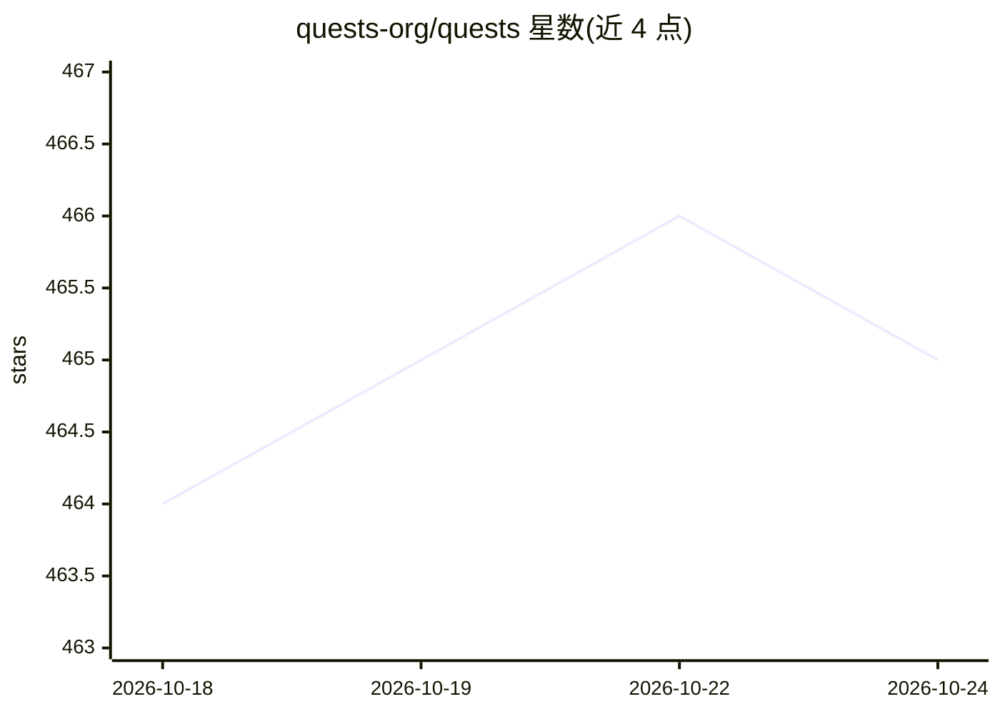

# quests-org/quests

⭐ 464 · TypeScript · Apache-2.0 · 推送 2026-04-07 · [GitHub](https://github.com/quests-org/quests) · [官网](https://quests.dev) · 组织维护

**开源桌面应用构建器：用任意 LLM 在本地生成并运行应用**

基于 Electron 的开源桌面应用（Apache 2.0），通过 BYOK 方式接入 OpenAI、Anthropic、Ollama 等 20+ AI 提供商，使用内置 coding agent 在用户本地构建并运行全栈应用；支持多项目并行、内置版本控制与恢复、应用导出、多模型输出对比评测（Evals）及开源模板发现页。monorepo 结构包含 studio 桌面端、workspace 核心 agent、本地 AI 网关与注入式控制平面。安装包从 quests.dev 下载，支持 macOS/Windows/Linux，开发者可从源码构建。

## 筛选速览

| 维度 | 判定 | 备注 |
|---|---|---|
| AI 角色 | `ai-native` | 本体是模型或模型工具 |
| 许可风险 | `permissive` | Apache-2.0 |
| 部署形态 | `None` |  |
| 模型依赖 | — | README 未给出锁定关系 |
| 硬件要求 | — | 无带数字的原话,不猜 |
| 安装摩擦 | `low` | 无编译、无系统依赖或容器化 |
| 成熟度 | — | 结构信号不足 |

## 能力要点

- BYOK 接入 20+ AI 提供商（含自定义 OpenAI 兼容端点）
- coding agent 本地构建并运行全栈应用，应用可导出
- 多模型输出对比评测（内置与自定义 prompt）
- monorepo：studio/workspace/本地 AI 网关/控制平面

## 适用场景

- 用自然语言让 AI 在本地生成并直接运行全栈应用
- 自带 API key 在多提供商之间切换做应用构建
- 对比不同模型生成应用的输出效果

## 场景标签

`编码 Agent` `模型评测` · 领域:编码与开发

## 证据(README 行号)

> L3:  The open-source app builder that builds and runs apps on your computer using any LLM.
> L16: - 🤖 Coding agent - State-of-the-art performance with targeted edits and real-time linting

## 星数曲线

2026-10-18 464 → 2026-10-24 465（+1）

---
*卡片 v1 · prompt 1.4 · 生成 2026-10-21 · 置信度 high · 依据 README sha `b2a8e9928939` · [字段定义](../../DATASET.md)*
