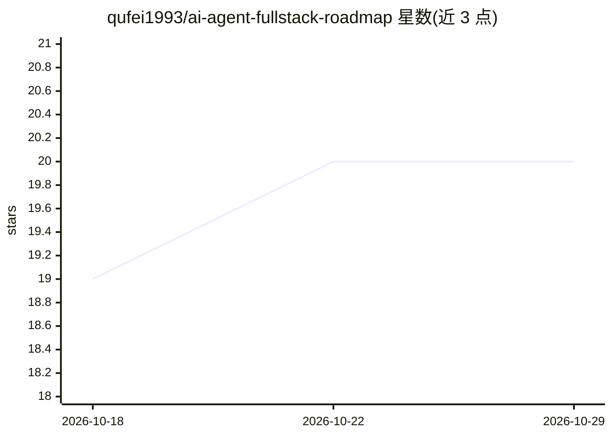

# qufei1993/ai-agent-fullstack-roadmap

⭐ 20 · CC-BY-4.0 · 推送 2026-06-19 · [GitHub](https://github.com/qufei1993/ai-agent-fullstack-roadmap) · 个人维护 · 中文 README

**面向 Node.js 前端开发者的 AI Agent 全栈学习路线图**

一份 AI Agent 全栈开发能力地图，面向有经验的 Node.js 与前端开发者，覆盖从 AI 辅助编程、LLM API 与结构化输出、RAG、Agent Loop 到生产化运维的 7 个阶段。定位为能力依赖关系图而非教程或工具排名，用核心路径、工程贯穿线、进阶选修三类标签标注优先级；假设读者已掌握数据库、Redis、OAuth、Docker，聚焦 AI 特有的增量能力。以 CC BY 4.0 许可的文档仓库形式提供，附中文版，接受 PR 贡献。

## 筛选速览

| 维度 | 判定 | 备注 |
|---|---|---|
| AI 角色 | `ai-knowledge` | 知识聚合/清单类 |
| 许可风险 | `viral` | CC-BY-4.0 |
| 部署形态 | `None` |  |
| 模型依赖 | — | README 未给出锁定关系 |
| 硬件要求 | — | 无带数字的原话,不猜 |
| 安装摩擦 | `low` | 无编译、无系统依赖或容器化 |
| 成熟度 | — | 结构信号不足 |

## 能力要点

- 7 阶段学习路径：AI 辅助开发→LLM API→RAG→Agent Loop→应用工程→生产化→运维
- 三色标签区分核心路径、工程贯穿线与进阶选修
- 明确声明非课程大纲、非工具排名，强调概念与能力依赖关系

## 适用场景

- Node.js/前端开发者规划转入 AI Agent 开发的学习路径
- 查漏补缺：对照能力地图确认已具备与待补的技能
- 了解 MCP、多 Agent、本地推理等进阶方向的分布

## 场景标签

`教程课程` · 领域:学习与行业

## 证据(README 行号)

> L5: A comprehensive capability map for **Node.js & frontend developers** transitioning into AI Agent full-stack developm
> L37: - **Not a course syllabus** — no step-by-step tutorials

## 星数曲线

2026-10-18 19 → 2026-10-29 20（+1）

---
*卡片 v1 · prompt 1.4 · 生成 2026-10-28 · 置信度 high · 依据 README sha `facad6471c3c` · [字段定义](../../DATASET.md)*
