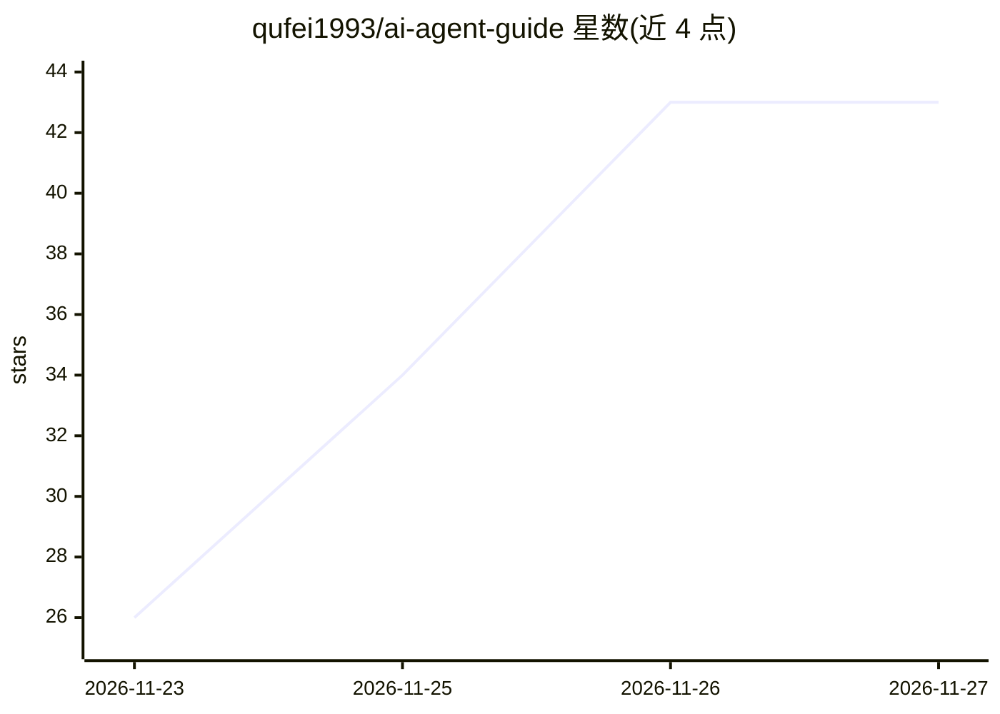

# qufei1993/ai-agent-guide

⭐ 43 · JavaScript · CC-BY-4.0 · 推送 2026-11-22 · [GitHub](https://github.com/qufei1993/ai-agent-guide) · [官网](https://qufei1993.github.io/ai-agent-guide/) · 个人维护 · 中文 README

**面向工程师的 LLM/Agent/RAG 开源交互式双语教程**

一个零构建、开源的交互式工程指南，覆盖 LLM、Agent 与 RAG 共 19 章，含英文与中文双语版本。每章将工程心智模型与浏览器实验配对，可调节参数、查看实时 payload、测试失败边界，并配有仓库内可运行的参考代码（TypeScript 示例，Node.js ≥22）。路线图分为概览、LLM 基础、Agent 核心机制、RAG 检索与溯源三个模块，部分章节标注为 Planned 未完成；明确排除 SFT/RL 后训练与复杂多 Agent 编排。站点通过 GitHub Pages 提供在线访问，本地可用 npm 脚本预览。

## 筛选速览

| 维度 | 判定 | 备注 |
|---|---|---|
| AI 角色 | `ai-knowledge` | 知识聚合/清单类 |
| 许可风险 | `viral` | CC-BY-4.0 |
| 部署形态 | `library` | 以包/库形式分发 |
| 模型依赖 | — | README 未给出锁定关系 |
| 硬件要求 | — | 无带数字的原话,不猜 |
| 安装摩擦 | `low` | 无编译、无系统依赖或容器化 |
| 成熟度 | — | 结构信号不足 |

## 能力要点

- 19 章双语课程（10 章双语就绪），含 mermaid 学习路线图
- 浏览器交互实验：调参、查看实时 payload、测试失败边界
- 仓库内可运行的 TypeScript 参考示例（Node.js ≥22）
- 零构建静态站点，无需安装即可本地预览

## 适用场景

- 系统学习 LLM 应用工程的提示词、结构化输出与上下文工程
- 按路线图掌握 Agent 工具调用、记忆与评估机制
- 学习 RAG 检索、混合搜索、引用溯源与评估方法
- 阅读失败边界实验来理解工程实践细节

## 场景标签

`教程课程` · 领域:学习与行业

## 证据(README 行号)

> L8: An open-source, zero-build **interactive engineering guide** to LLMs, Agents, and RAG. Every chapter pairs concise e
> L13: ## Learning Roadmap
> L26: ## Curriculum (19 Chapters · 10 Bilingual Ready)

## 星数曲线

2026-11-23 26 → 2026-11-27 43（+17）

---
*卡片 v1 · prompt 1.4 · 生成 2026-11-23 · 置信度 high · 依据 README sha `edc7463f1191` · [字段定义](../../DATASET.md)*
