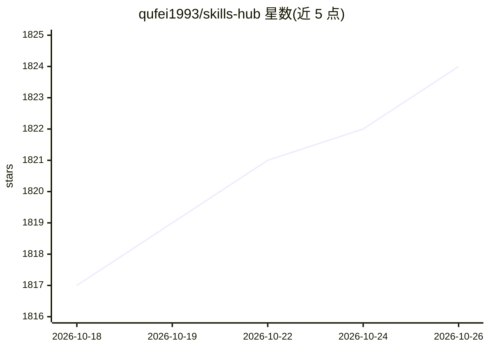

# qufei1993/skills-hub

⭐ 1,824 · Rust · MIT · 推送 2026-10-23 · [GitHub](https://github.com/qufei1993/skills-hub) · [官网](https://aiskillshub.link) · 个人维护 · 中文 README

**跨平台桌面应用：统一管理 Agent Skills 并同步到 48 种 AI 编码工具**

基于 Tauri/React 的桌面应用（macOS/Windows/Linux 提供下载），用于集中安装和管理 AI Agent Skills：可从应用内置集合、网站、Git 仓库或本地文件夹导入，按标签组织、批量启用/禁用与更新，并同步到 Claude Code、Codex、Cursor 等 48 种 AI 编码工具的全局或项目级技能目录。支持通过 GitHub/GitLab/Gitee 仓库跨设备同步，另提供 AI 管理模式与独立 CLI。

## 筛选速览

| 维度 | 判定 | 备注 |
|---|---|---|
| AI 角色 | `ai-ecosystem` | LLM/agent 周边工具 |
| 许可风险 | `permissive` | MIT |
| 部署形态 | `library` | 以包/库形式分发 |
| 模型依赖 | — | README 未给出锁定关系 |
| 硬件要求 | — | 无带数字的原话,不猜 |
| 安装摩擦 | `low` | 无编译、无系统依赖或容器化 |
| 成熟度 | — | 结构信号不足 |

## 能力要点

- 支持 48 种 AI 编码工具的技能目录同步，含自定义目录
- 从集合、Git、本地文件夹导入并按标签批量管理
- 通过 GitHub/GitLab/Gitee 仓库跨设备同步 Skills
- AI 管理模式让编码 agent 代为安装与整理 Skills（无需 Node.js/npm）

## 适用场景

- 在多个 AI 编码工具间复用同一套 Agent Skills
- 按任务从集合中挑选并批量安装 Skills
- 在多台设备间保持技能库一致

## 场景标签

`提示工程` · 领域:Agent 开发

## 证据(README 行号)

> L5: One place for your AI Agent Skills. Install them once, then sync them to the coding tools and projects you use.
> L27: Skills Hub supports **48 AI coding tools**, including Claude Code, Codex, Cursor, and OpenCode. Custom tool directo

## 星数曲线

2026-10-18 1,817 → 2026-10-26 1,824（+7）

---
*卡片 v1 · prompt 1.4 · 生成 2026-10-21 · 置信度 mid · 依据 README sha `c3840584cbd0` · [字段定义](../../DATASET.md)*
