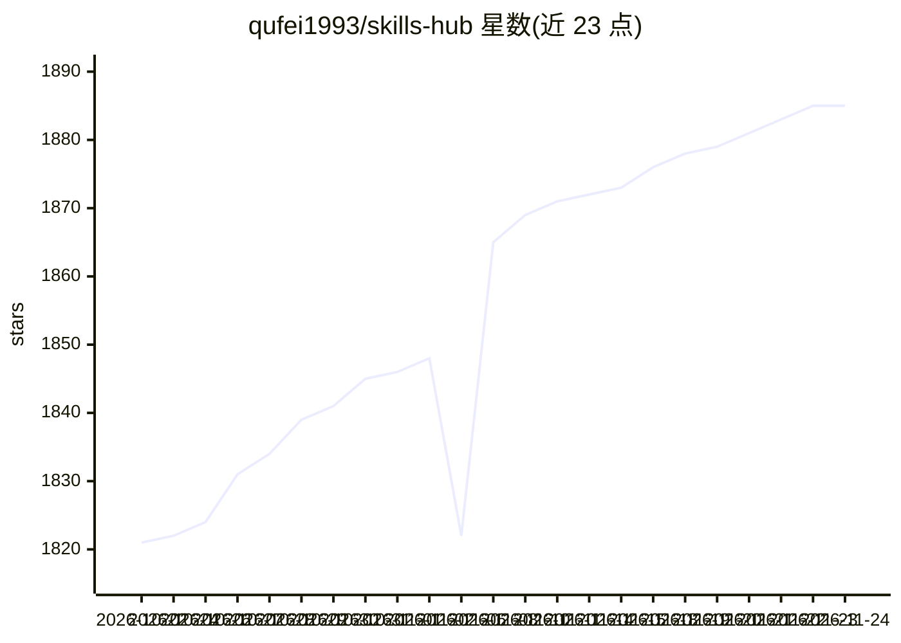

# qufei1993/skills-hub

⭐ 1,886 · Rust · MIT · 推送 2026-11-23 · [GitHub](https://github.com/qufei1993/skills-hub) · [官网](https://aiskillshub.link) · 个人维护 · 中文 README

**跨平台桌面应用：统一管理 Agent Skills 并同步到多个 AI 编码工具**

基于 Tauri（Rust+React）的桌面应用，将 Agent Skills 集中在统一库中管理，再同步到用户指定的 AI 编码工具的全局或项目级 skills 目录，口号为 "Install once, sync everywhere"。支持浏览任务导向的技能集合、从 Git 或本地文件夹导入、按标签批量启停与更新，并可通过 GitHub/GitLab/Gitee 仓库跨设备同步。还提供独立 CLI，并支持让编码 agent 通过同一技能库安装与整理技能。提供 macOS/Windows/Linux 安装包。

## 筛选速览

| 维度 | 判定 | 备注 |
|---|---|---|
| AI 角色 | `ai-ecosystem` | LLM/agent 周边工具 |
| 许可风险 | `permissive` | MIT |
| 部署形态 | `library` | 以包/库形式分发 |
| 模型依赖 | — | README 未给出锁定关系 |
| 硬件要求 | — | 无带数字的原话,不猜 |
| 安装摩擦 | `low` | 无编译、无系统依赖或容器化 |
| 成熟度 | — | 结构信号不足 |

## 能力要点

- 支持 48 个 AI 编码工具的 skills 目录同步（含 Claude Code、Codex、Cursor、OpenCode）
- 支持从 Git 和本地文件夹导入技能，提供集合浏览与搜索
- 标签批量管理与保留设置的批量更新
- 支持让编码 agent 直接管理技能库，无需 Node.js 或 npm

## 适用场景

- 在 Claude Code、Codex、Cursor 等多个工具间统一安装同一套 Agent Skills
- 通过 Git 仓库在多台设备间同步技能文件与标签
- 批量启停和更新已安装的技能

## 场景标签

`提示工程` · 领域:Agent 开发

## 证据(README 行号)

> L5: One place for your AI Agent Skills. Install them once, then sync them to the coding tools and projects you use.
> L20: - **Sync to your tools**: Choose target tools and global or supported project scope, or add a custom directory.
> L27: Skills Hub supports **48 AI coding tools**, including Claude Code, Codex, Cursor, and OpenCode. Custom tool directo

## 星数曲线

2026-10-22 1,821 → 2026-11-24 1,885（+64）

---
*卡片 v1 · prompt 1.4 · 生成 2026-11-23 · 置信度 mid · 依据 README sha `b76b855bee06` · [字段定义](../../DATASET.md)*
