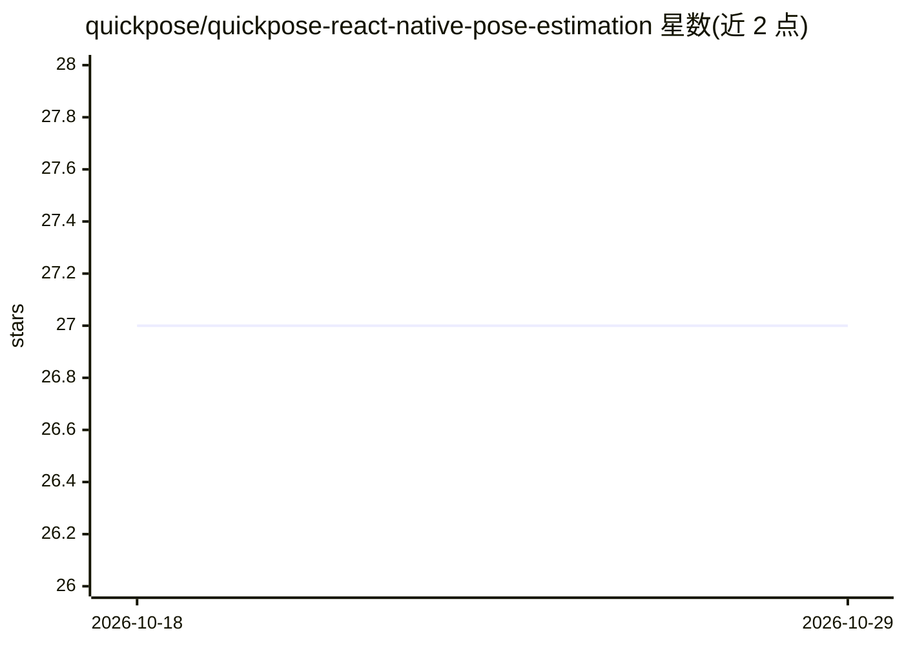

# quickpose/quickpose-react-native-pose-estimation

⭐ 27 · TypeScript · 推送 2026-08-26 · [GitHub](https://github.com/quickpose/quickpose-react-native-pose-estimation) · [官网](https://quickpose.ai) · 组织维护

**React Native 姿态估计插件：接入 QuickPose SDK 实现体感追踪**

面向 React Native 开发者的插件，封装 QuickPose 姿态估计 SDK，在 iOS 与 Android 上提供实时身体追踪、骨骼叠加显示、关节活动度测量、19 种健身动作计数（深蹲/俯卧撑/平板支撑等）及手势识别（举指/点赞）。iOS 需 CocoaPods 安装原生依赖，Android 由 Gradle 自动解析；使用需在 dev.quickpose.ai 注册 SDK key。相机功能要求物理设备，模拟器不可用。附带四个示例工程（基础叠加/实时反馈/功能选择器/手动桥接参考）。

## 筛选速览

| 维度 | 判定 | 备注 |
|---|---|---|
| AI 角色 | `ai-ecosystem` | LLM/agent 周边工具 |
| 许可风险 | `none` | — |
| 部署形态 | `library` | 以包/库形式分发 |
| 模型依赖 | — | README 未给出锁定关系 |
| 硬件要求 | — | 无带数字的原话,不猜 |
| 安装摩擦 | `low` | 无编译、无系统依赖或容器化 |
| 成熟度 | — | 结构信号不足 |

## 能力要点

- 实时身体追踪与 33 个身体关键点骨骼叠加
- 19 种健身动作的次数计数与实时反馈
- 10 个关节部位的活动度（ROM）测量
- 举指、点赞等手势与输入识别

## 适用场景

- 在 React Native 应用中集成实时姿态追踪与骨骼叠加
- 开发健身训练类应用，实现动作计数与实时纠正反馈
- 通过手势（举指/点赞）作为应用输入

## 场景标签

`目标检测` · 领域:感知与多模态

## 证据(README 行号)

> L3: React Native plugin for QuickPose ML pose estimation SDK. Provides real-time body tracking, fitness rep counting, ra
> L8: npm install @quickpose/react-native

## 星数曲线

2026-10-18 27 → 2026-10-29 27（+0）

---
*卡片 v1 · prompt 1.4 · 生成 2026-10-26 · 置信度 high · 依据 README sha `7c2e4007403e` · [字段定义](../../DATASET.md)*
