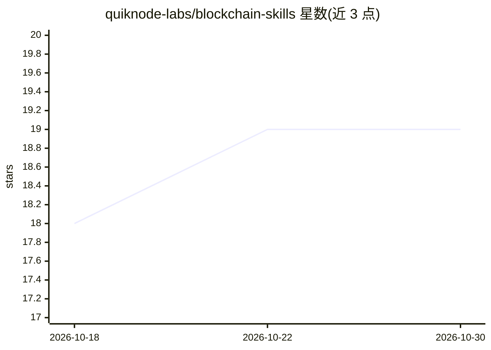

# quiknode-labs/blockchain-skills

⭐ 19 · MIT · 推送 2026-08-12 · [GitHub](https://github.com/quiknode-labs/blockchain-skills) · [官网](https://www.quicknode.com) · 组织维护

**面向编码 agent 的区块链开发技能集合（Quicknode）**

QuickNode 维护的 AI agent 技能仓库：以 SKILL.md 结构化指令集形式，为 Claude Code、Codex、Cursor 等编码 agent 提供区块链领域知识与操作指引。目前收录 quicknode-skill 一个技能，覆盖 80+ 链的 RPC、实时数据（Streams/Webhooks）、索引数据（SQL/DAS/Ordinals）、Swap API 及 x402/MPP 稳定币付费访问等产品。通过 npx skills add 安装，MIT 许可。技能数量目前仅一个，结构上预留扩展。

## 筛选速览

| 维度 | 判定 | 备注 |
|---|---|---|
| AI 角色 | `ai-knowledge` | 知识聚合/清单类 |
| 许可风险 | `permissive` | MIT |
| 部署形态 | `library` | 以包/库形式分发 |
| 模型依赖 | — | README 未给出锁定关系 |
| 硬件要求 | — | 无带数字的原话,不猜 |
| 安装摩擦 | `low` | 无编译、无系统依赖或容器化 |
| 成熟度 | — | 结构信号不足 |

## 能力要点

- SKILL.md 结构化技能定义，附产品目录与 API 参考文件
- 接入 QuickNode 全线产品：RPC、Streams、Webhooks、SQL Explorer、Swap API、MCP 等
- x402/MPP 免费额度：每钱包每月 100 万 API credits
- npx skills add 一条命令安装

## 适用场景

- 让 Claude Code/Codex 等 agent 用自然语言查询链上数据与管理 QuickNode 端点
- 通过 agent 设置区块监控 Stream、Webhook 通知与历史回填
- 让 agent 执行多 DEX 聚合换币报价查询

## 场景标签

 · 领域:区块链/开发工具

## 证据(README 行号)

> L3: > A collection of AI agent skills for blockchain development, powered by Quicknode
> L11: Skills are structured instruction sets that AI agents can use to perform blockchain-related tasks. They provide:

## 星数曲线

2026-10-18 18 → 2026-10-30 19（+1）

---
*卡片 v1 · prompt 1.4 · 生成 2026-10-28 · 置信度 high · 依据 README sha `605fe3d37cbe` · [字段定义](../../DATASET.md)*
