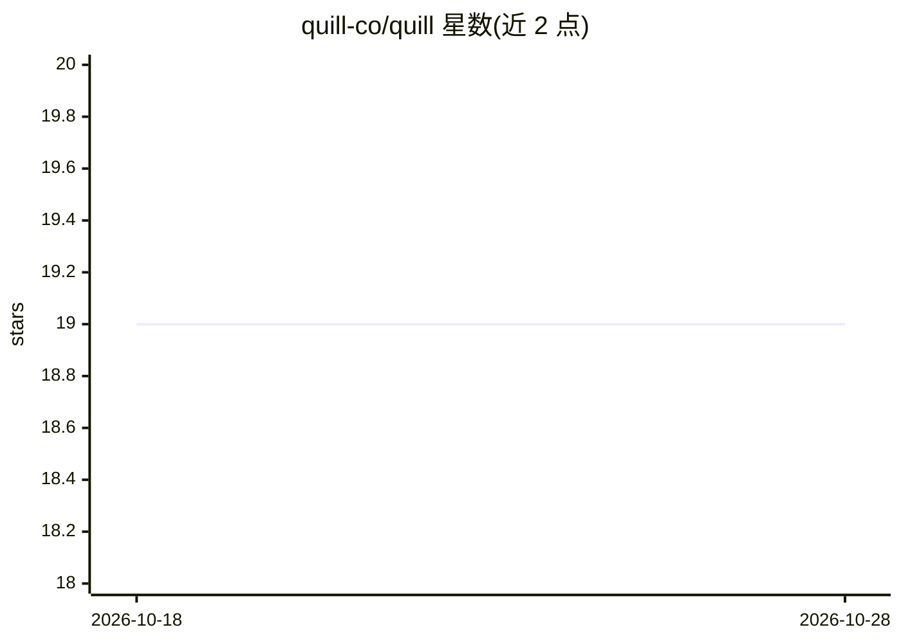

# quill-co/quill

⭐ 19 · TypeScript · 推送 2026-01-30 · [GitHub](https://github.com/quill-co/quill) · 组织维护

**求职者自动填写投递职位申请的 AI Web 应用**

Quill 是一套自动化求职申请系统：用户上传 PDF/DOC/DOCX 简历（≤10MB），选择面向不同职位类型的 AI 模型，系统自动填写并提交多份职位申请，通过 8080 端口的 WebSocket 实时推送初始化、填写表单、上传简历、完成等状态。前端为 Next.js + TypeScript + Tailwind CSS，简历处理与 AI 表单填充由独立的 quill-backend 后端服务承担。通过 npm/yarn 运行开发服务器启动。

## 筛选速览

| 维度 | 判定 | 备注 |
|---|---|---|
| AI 角色 | `ai-native` | 本体是模型或模型工具 |
| 许可风险 | `none` | — |
| 部署形态 | `None` |  |
| 模型依赖 | — | README 未给出锁定关系 |
| 硬件要求 | — | 无带数字的原话,不猜 |
| 安装摩擦 | `low` | 无编译、无系统依赖或容器化 |
| 成熟度 | — | 结构信号不足 |

## 能力要点

- 上传简历后 AI 自动填写并提交职位申请
- WebSocket 实时推送每个申请的状态
- 支持按职位类型选择不同 AI 模型
- 前端 Next.js/TypeScript，后端为独立仓库 quill-backend

## 适用场景

- 批量投递多个职位时自动填写申请表
- 实时查看每份申请的填写与提交进度

## 场景标签

`浏览器自动化` · 领域:效率与自动化

## 证据(README 行号)

> L5: Quill is an intelligent job application automation system that streamlines the process of applying to multiple job p
> L51: |Filling Out Form|AI is completing application fields|
> L81: - Running AI models for form completion

## 星数曲线

2026-10-18 19 → 2026-10-28 19（+0）

---
*卡片 v1 · prompt 1.4 · 生成 2026-10-28 · 置信度 high · 依据 README sha `84fab7af4572` · [字段定义](../../DATASET.md)*
