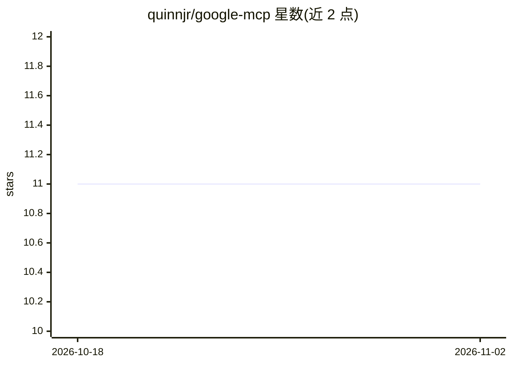

# quinnjr/google-mcp

⭐ 11 · TypeScript · MIT · 推送 2026-09-03 · [GitHub](https://github.com/quinnjr/google-mcp) · 个人维护

**覆盖 Google Workspace 全家桶的 MCP 服务器，供 AI 客户端操作**

为 Google Calendar、Gmail、Drive、Docs、Sheets、Slides、Meet、Chat、Forms、YouTube、Tasks、Contacts 提供 MCP 工具层的 Node.js 服务器，以 OAuth 2.0 完成一次认证后多客户端共享会话。通过 Streamable HTTP（/mcp）与旧版 SSE 传输暴露工具，本地文件读写限制在单一沙箱目录并拒绝触碰密钥类文件，以防范来自邮件内容的提示注入。使用前需在 Google Cloud 启用相应 API 并配置 OAuth 凭据；克隆源码后构建运行，监听 127.0.0.1:3015。Google Keep 因无公开 API，以 Tasks 实现类笔记功能。

## 筛选速览

| 维度 | 判定 | 备注 |
|---|---|---|
| AI 角色 | `ai-ecosystem` | LLM/agent 周边工具 |
| 许可风险 | `permissive` | MIT |
| 部署形态 | `None` |  |
| 模型依赖 | — | README 未给出锁定关系 |
| 硬件要求 | — | 无带数字的原话,不猜 |
| 安装摩擦 | `low` | 无编译、无系统依赖或容器化 |
| 成熟度 | — | 结构信号不足 |

## 能力要点

- 12 项 Google 服务、130+ 个 MCP 工具
- OAuth 2.0 一次认证，多客户端/agent 共享同一授权会话
- 本地文件操作限制在沙箱目录，拒绝对密钥/凭据类文件的访问
- 同时提供 Streamable HTTP 与旧版 SSE 传输

## 适用场景

- 让 Claude/Cursor 等 MCP 客户端直接读写我的 Gmail 与日历
- 通过对话式 agent 管理 Drive 文件与 Sheets/Docs 内容
- 在自建 agent 中接入 Google Workspace 数据与操作能力

## 场景标签

 · 领域:AI 工具接入/生产力集成

## 证据(README 行号)

> L3: A comprehensive Model Context Protocol (MCP) server for Google integration, providing access to Google Calendar, Doc
> L161: ## Usage with MCP Clients
> L163: The server runs as a long-lived pooled worker, not as a stdio subprocess. It

## 星数曲线

2026-10-18 11 → 2026-11-02 11（+0）

---
*卡片 v1 · prompt 1.4 · 生成 2026-11-01 · 置信度 high · 依据 README sha `9586d760f579` · [字段定义](../../DATASET.md)*
