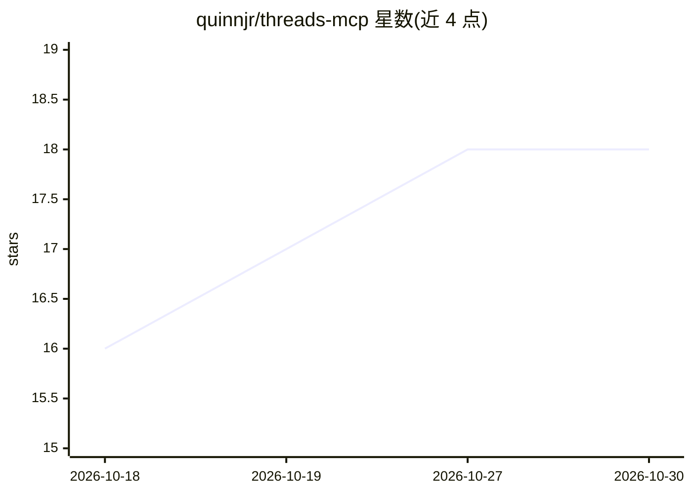

# quinnjr/threads-mcp

⭐ 18 · TypeScript · MIT · 推送 2026-04-15 · [GitHub](https://github.com/quinnjr/threads-mcp) · [官网](https://quinnjr.github.io/threads-mcp/) · 个人维护

**Threads.com API 的 MCP 服务器：让 AI 助手读写 Threads 内容**

用 TypeScript 实现的 Model Context Protocol 服务器，封装 Threads.com API v1.0，供 Claude Desktop 等 MCP 客户端调用。提供 8 个工具覆盖资料获取、发帖（文本/图片/视频）、回复、互动数据与对话读取。内置 OAuth 2.0 自动授权流程（浏览器授权、token 自动刷新）、令牌桶限流、带 TTL 与 LRU 淘汰的内存缓存及 webhook 支持。用户需 Node.js 18+、pnpm、Meta 开发者账号与 Threads 账号；测试覆盖率声明大于 90%。

## 筛选速览

| 维度 | 判定 | 备注 |
|---|---|---|
| AI 角色 | `ai-ecosystem` | LLM/agent 周边工具 |
| 许可风险 | `permissive` | MIT |
| 部署形态 | `library` | 以包/库形式分发 |
| 模型依赖 | locked-api |  |
| 硬件要求 | — | 无带数字的原话,不猜 |
| 安装摩擦 | `low` | 无编译、无系统依赖或容器化 |
| 成熟度 | — | 结构信号不足 |

## 能力要点

- 8 个 MCP 工具覆盖发帖、回复、洞察数据与对话读取
- OAuth 2.0 自动授权，token 存储并自动刷新
- 令牌桶限流 + TTL/LRU 内存缓存
- TypeScript + Zod 校验，测试覆盖率声明 >90%

## 适用场景

- 在 Claude Desktop 中直接创建和管理 Threads 帖子
- 让 AI 助手查询账号或单帖的互动分析数据
- 通过对话获取与回复 Threads 会话

## 场景标签

 · 领域:社交平台工具/AI 集成

## 证据(README 行号)

> L15: - 🔧 **MCP Protocol** - Standard Model Context Protocol implementation
> L65: 2. **Configure Claude Desktop**

## 星数曲线

2026-10-18 16 → 2026-10-30 18（+2）

---
*卡片 v1 · prompt 1.4 · 生成 2026-10-29 · 置信度 high · 依据 README sha `23ef91e2d91a` · [字段定义](../../DATASET.md)*
