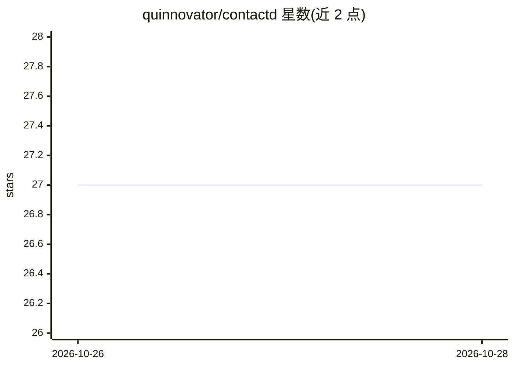

# quinnovator/contactd

⭐ 27 · Go · Apache-2.0 · 推送 2026-10-26 · [GitHub](https://github.com/quinnovator/contactd) · 个人维护

**单二进制 Go 服务：以“联系人”方式持续对话 AI，含记忆与沙箱**

一个 Go 单二进制，后端 SQLite 与两个本地 ONNX 模型（bge-small 嵌入 + MiniLM 重排），客户端通过联系人 ID 发消息，线程、提示缓存布局与 REPL 环境均由一条 append-only 事件日志即时派生：分集召回相关旧对话、五层提示布局以复用提供商前缀缓存（模拟中暖轮次 87% 输入 token 命中）、按需启动 WebAssembly 内的 Python/JS 沙箱。支持 DeepSeek、Anthropic、OpenRouter、Ollama Cloud 及 OpenAI 兼容服务（vLLM、SGLang）。自带 Bubbletea 终端客户端与 HTTP API；API 自身无鉴权，面向可信网络。通过 git clone + mise 从源码构建，或 Docker 容器运行（linux/amd64、arm64、Apple Silicon；Windows 未测试）。

## 筛选速览

| 维度 | 判定 | 备注 |
|---|---|---|
| AI 角色 | `ai-ecosystem` | LLM/agent 周边工具 |
| 许可风险 | `permissive` | Apache-2.0 |
| 部署形态 | `self-host` | docker 或自建部署 |
| 模型依赖 | local-ok | 支持本地模型 |
| 硬件要求 | — | 无带数字的原话,不猜 |
| 安装摩擦 | `low` | 无编译、无系统依赖或容器化 |
| 成熟度 | `idea` | |

## 能力要点

- JIT 线程/缓存/环境全部由一条 append-only 事件日志即时派生
- 本地 ONNX 嵌入 + 交叉编码器重排召回过往对话分集
- 五层提示布局预测并校验提供商前缀缓存命中（暖轮次 87%）
- WebAssembly 进程内 Python/JS 沙箱运行模型代码，含内存与时间限制

## 适用场景

- 开发者以终端客户端或 HTTP API 维持与 AI 联系人的长期持续对话
- 需要长期记忆与提示缓存优化的本地 AI 联系人服务
- 在沙箱中让模型执行 Python/JS 代码并保留联系人文件

## 场景标签

`Agent 记忆` `AI 助手` · 领域:Agent 开发

## 证据(README 行号)

> L5: One Go binary, backed by SQLite and two small local ONNX models, that lets a client talk to an AI contact the way it
> L101: DeepSeek, Anthropic, OpenRouter, OpenCode Go, Ollama Cloud, and any OpenAI-compatible server (vLLM, SGLang, …). Ev
> L136: The event log is the only stored state. Each contact that is talking has one actor goroutine that owns it and is i

## 星数曲线

2026-10-26 27 → 2026-10-28 27（+0）

---
*卡片 v1 · prompt 1.4 · 生成 2026-10-26 · 置信度 high · 依据 README sha `e5b2d31b5150` · [字段定义](../../DATASET.md)*
