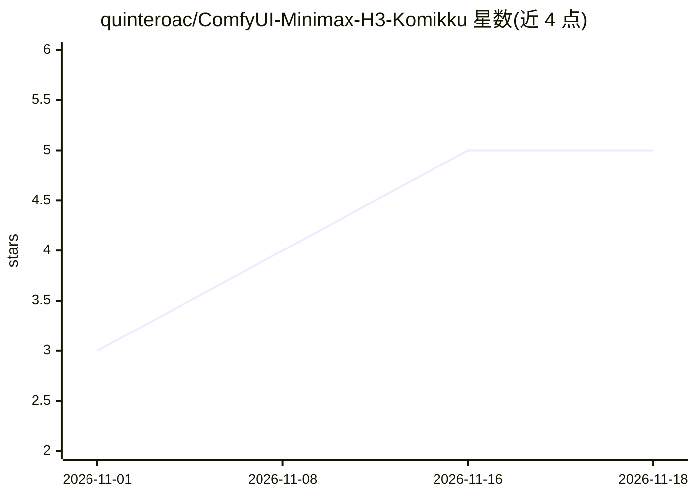

# quinteroac/ComfyUI-Minimax-H3-Komikku

⭐ 5 · JavaScript · MIT · 推送 2026-10-31 · [GitHub](https://github.com/quinteroac/ComfyUI-Minimax-H3-Komikku) · 个人维护

**将 MiniMax H3 多镜头视频转为漫画页的 ComfyUI 节点包**

一组 ComfyUI 自定义节点与示例工作流：先在页面布局编辑器中设计漫画页，每个分格对应视频的一个硬切镜头，由 MiniMax H3 ref2vid 生成多镜头视频后，再从每个镜头取中间帧裁回分格并合成整页。提供 15 种布局模板、从已有漫画页导入分格、8 类气泡文字与本地字体安装，文本辅助改写通过 CLIP Loader 懒加载运行。还提供 window.komikku Agent API 及基于 Playwright 的 agent skill，可由 Claude Code 驱动无头 Chromium 完成排版与文字。

## 筛选速览

| 维度 | 判定 | 备注 |
|---|---|---|
| AI 角色 | `ai-native` | 本体是模型或模型工具 |
| 许可风险 | `permissive` | MIT |
| 部署形态 | `None` |  |
| 模型依赖 | — | README 未给出锁定关系 |
| 硬件要求 | — | 无带数字的原话,不猜 |
| 安装摩擦 | `low` | 无编译、无系统依赖或容器化 |
| 成熟度 | — | 结构信号不足 |

## 能力要点

- 页面布局编辑器：15 种模板、刀具斜切、阅读顺序可设漫画/美漫
- 分格导入：可配 WeVisOne-VL-4B 模型检测无边框分格，约 2 秒/页
- 硬切镜头取帧无需额外依赖，帧数与分格数严格对应
- Agent API 与 agent skill 支持脚本/agent 设计并渲染漫画页

## 适用场景

- 把参考图生成的多镜头视频排版成完整漫画页
- 从现有漫画/漫画页复制分格布局再重新创作
- 用 agent 自动完成页面排版、写镜头提示词和加气泡文字

## 场景标签

`视频生成` · 领域:内容生成

## 证据(README 行号)

> L3: This pack turns a MiniMax H3 reference-to-video multishot generation into a manga or comic page. You design the page
> L63: Agents and scripts can design and letter pages through `window.komikku` in the ComfyUI page. It provides templates,

## 星数曲线

2026-11-01 3 → 2026-11-18 5（+2）

---
*卡片 v1 · prompt 1.4 · 生成 2026-11-24 · 置信度 high · 依据 README sha `9ba333f00766` · [字段定义](../../DATASET.md)*
