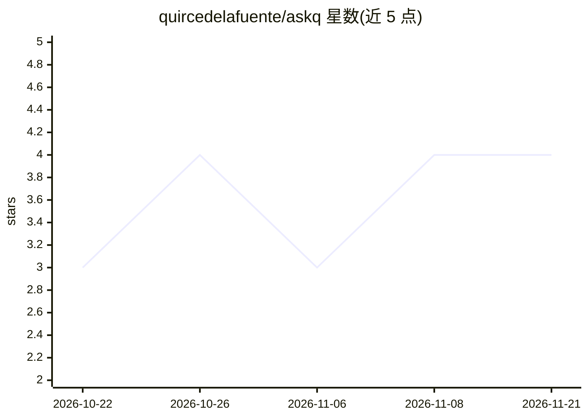

# quircedelafuente/askq

⭐ 4 · JavaScript · MIT · 推送 2026-11-05 · [GitHub](https://github.com/quircedelafuente/askq) · 个人维护

**自托管个人 AI 助手：经 Siri/WhatsApp/Telegram 驱动本机工具**

在用户自己的机器（免费云服务器、Mac/Linux/树莓派/WSL2）上运行 Claude Code（或 Codex、Cursor、Antigravity）作为引擎，并通过 MCP 服务器形式为它挂载可执行工具：订票、提醒、发文件等。用户从 Siri、WhatsApp、Telegram 或电话语音下达指令，机器经 Tailscale 私有连接，不对公网暴露；有付费/预订/发送类操作先询问用户。用户还可用自然语言让它在无 API 的网站上构建新工具，安装脚本会补齐 git、Node.js 等依赖。

## 筛选速览

| 维度 | 判定 | 备注 |
|---|---|---|
| AI 角色 | `ai-ecosystem` | LLM/agent 周边工具 |
| 许可风险 | `permissive` | MIT |
| 部署形态 | `None` |  |
| 模型依赖 | locked-api |  |
| 硬件要求 | — | 无带数字的原话,不猜 |
| 安装摩擦 | `low` | 无编译、无系统依赖或容器化 |
| 成熟度 | — | 结构信号不足 |

## 能力要点

- 以 Claude Code/Codex/Cursor/Antigravity 为可切换引擎，运行在用户自有机器上
- 对话生成新工具，工具为标准 MCP server，可复用于 Claude Desktop 等客户端
- Siri 快捷指令、WhatsApp/Telegram 消息与电话语音三种入口
- Tailscale 私有通道访问，付费/预订/发送类操作先征求确认

## 适用场景

- 用自己的票务账号买票并把 PDF 发到 WhatsApp
- 用语音/消息让助手查日历、邮件和学校门户并设提醒
- 给它没有 API 的网站，让它生成一个可调用的工具

## 场景标签

`AI 助手` `浏览器自动化` · 领域:效率与自动化

## 证据(README 行号)

> L7: Ask Q runs Claude Code (or Codex, Cursor or Antigravity) on **your** machine (a free cloud server or your own comput
> L32: - **Build your own tools by asking.** Every tool is a standard MCP server, so it also works in Claude Desktop, Clau

## 星数曲线

2026-10-22 3 → 2026-11-21 4（+1）

---
*卡片 v1 · prompt 1.4 · 生成 2026-11-21 · 置信度 high · 依据 README sha `edf3a496331c` · [字段定义](../../DATASET.md)*
