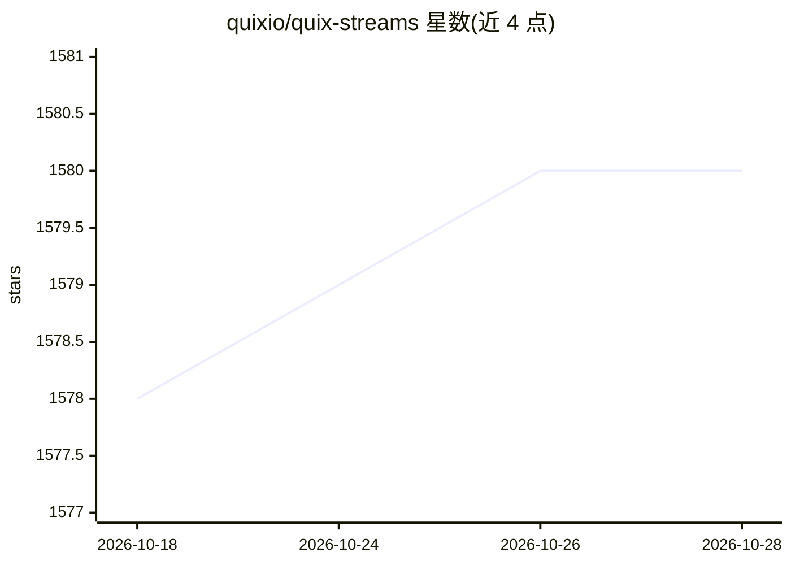

# quixio/quix-streams

⭐ 1,581 · Python · Apache-2.0 · 推送 2026-10-27 · [GitHub](https://github.com/quixio/quix-streams) · [官网](https://docs.quix.io) · 组织维护

**面向 Apache Kafka 的 Python 流处理框架**

纯 Python 的实时数据工程框架，提供 Streaming DataFrame API 在 Kafka 数据流上构建提取、转换、加载管道与事件驱动微服务，无需管理服务端集群。支持自定义 Sources & Sinks 连接器、JSON/Avro/Protobuf 与 Schema Registry 序列化、容错有状态操作、窗口/分支/分组算子、流式 Join，并通过 Kafka 事务实现精确一次处理。面向数据工程师与开发者，可部署到任意 Python 环境，也可接入 Quix Cloud 托管平台。要求 Python 3.11+ 与 Apache Kafka 0.10+。

## 筛选速览

| 维度 | 判定 | 备注 |
|---|---|---|
| AI 角色 | `ai-enhanced` | 去掉 AI 部分产品仍成立 |
| 许可风险 | `permissive` | Apache-2.0 |
| 部署形态 | `library` | 以包/库形式分发 |
| 模型依赖 | — | README 未给出锁定关系 |
| 硬件要求 | — | 无带数字的原话,不猜 |
| 安装摩擦 | `low` | 无编译、无系统依赖或容器化 |
| 成熟度 | — | 结构信号不足 |

## 能力要点

- Streaming DataFrame API 构建表格化流处理管道
- 支持 JSON/Avro/Protobuf 与 Schema Registry 序列化
- 容错有状态操作与 Kafka 事务的精确一次保证
- 纯 Python 实现，无 Java 包装与服务端集群管理

## 适用场景

- 用熟悉的 Python 库在 Kafka 上构建实时 ETL 管道
- 搭建事件驱动微服务与实时数据分析
- 构建实时数据管道支撑 AI/ML 产品
- 编写 Kafka 生产者/消费者应用

## 场景标签

 · 领域:数据工程/流处理

## 证据(README 行号)

> L13: Quix Streams is an end-to-end framework for real-time Python data engineering, operational analytics and machine le
> L29: Use Quix Streams to build simple Kafka producer/consumer applications or leverage stream processing to build comple

## 星数曲线

2026-10-18 1,578 → 2026-10-28 1,580（+2）

---
*卡片 v1 · prompt 1.4 · 生成 2026-10-21 · 置信度 mid · 依据 README sha `bf0090ec76e4` · [字段定义](../../DATASET.md)*
