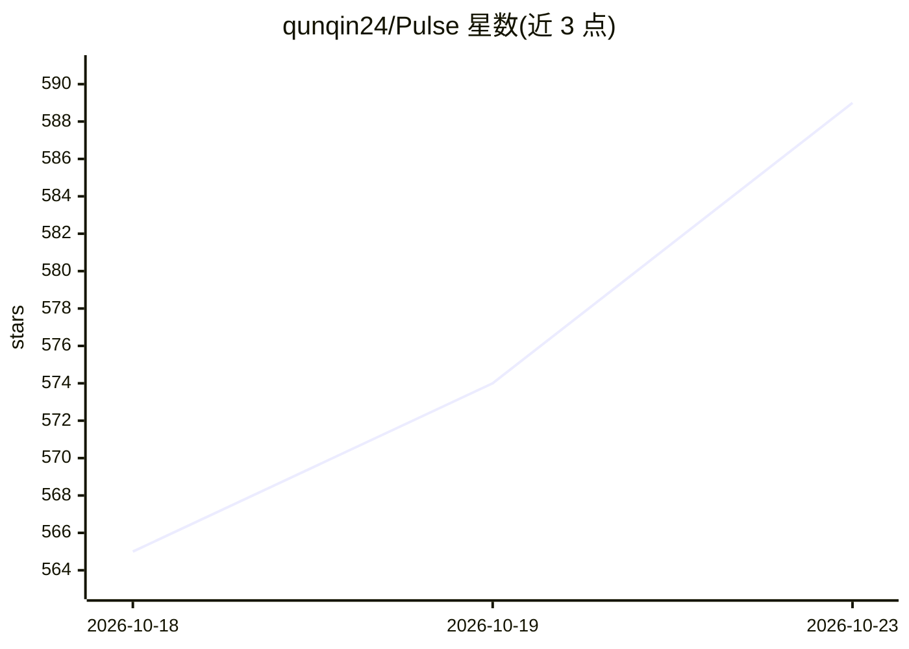

# qunqin24/Pulse

⭐ 589 · Swift · Apache-2.0 · 推送 2026-10-21 · [GitHub](https://github.com/qunqin24/Pulse) · [官网](https://github.com/qunqin24/Pulse/releases/latest) · 个人维护 · 中文 README

**macOS 悬浮监控条：一屏查看 76 种 AI 编程工具剩余额度**

用 Swift/SwiftUI 编写的 macOS 桌面应用，在屏幕边缘显示悬浮轨道，以环形指示器展示 Claude Code、Codex、Cursor、GitHub Copilot 等 76 种 AI 编程服务的用量百分比与重置时间。读取本机已有登录凭据直接向各服务自身端点查询，无需独立账号或服务器；百分比由服务自身报告，估算值会标注。附加功能包括 token 花费统计（按公开 API 价格折算）、44 家服务商状态页监测、通知、多语言。通过 dmg 安装包或 Xcode 源码构建，要求 macOS 14+。

## 筛选速览

| 维度 | 判定 | 备注 |
|---|---|---|
| AI 角色 | `ai-ecosystem` | LLM/agent 周边工具 |
| 许可风险 | `permissive` | Apache-2.0 |
| 部署形态 | `desktop` | 安装包/桌面程序 |
| 模型依赖 | — | README 未给出锁定关系 |
| 硬件要求 | — | 无带数字的原话,不猜 |
| 安装摩擦 | `low` | 无编译、无系统依赖或容器化 |
| 成熟度 | — | 结构信号不足 |

## 能力要点

- 76 种 AI 编程服务的用量环与重置时间显示
- 直接使用本机已有登录，无 Pulse 账号与服务器
- token 花费统计（54 个本地客户端，多币种估算）
- 44 家服务商状态页监测与中断通知

## 适用场景

- 不开各服务用量页，一眼查看多个 AI 编程工具的剩余额度
- 接近限额时收到通知，避免突发限流
- 按天/模型/agent 统计本地 token 花费并折算费用

## 场景标签

 · 领域:开发者工具/用量监控

## 证据(README 行号)

> L5:  Know how much Claude Code, Codex and Cursor you have left — without opening a single usage page.
> L21: - **Seventy-six services at a glance** — Claude Code, Codex, Cursor, GitHub Copilot, Antigravity, Kiro, Grok, DeepS
> L90: - **No Pulse account, no Pulse server** — your Mac talks to the services you use, under your own logins.

## 星数曲线

2026-10-18 565 → 2026-10-23 589（+24）

---
*卡片 v1 · prompt 1.4 · 生成 2026-10-22 · 置信度 high · 依据 README sha `8001389446cf` · [字段定义](../../DATASET.md)*
