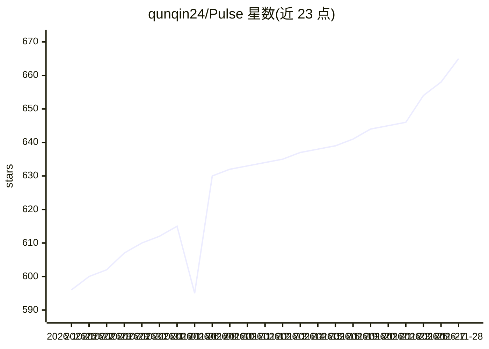

# qunqin24/Pulse

⭐ 665 · Swift · Apache-2.0 · 推送 2026-11-27 · [GitHub](https://github.com/qunqin24/Pulse) · [官网](https://github.com/qunqin24/Pulse/releases/latest) · 个人维护 · 中文 README

**macOS 屏幕边缘悬浮条：实时显示 78 个 AI 编程工具的用量余量**

开源 macOS 原生应用（Swift/SwiftUI），以屏幕边缘悬浮条和菜单栏形式展示各 AI 编程服务的用量环形图：每个限值、重置时间、燃烧率预测、当日/当月用量回顾卡片，以及 44 个服务商的状态页与宕机通知。读取用户已有的各服务登录凭据，用量百分比取自服务自身上报数据；无 Pulse 账号与服务器，密钥加密存于本机。支持 6 种语言，需 macOS 14+，从 Release 下载 dmg 安装或用 Xcode 源码构建。

## 筛选速览

| 维度 | 判定 | 备注 |
|---|---|---|
| AI 角色 | `ai-ecosystem` | LLM/agent 周边工具 |
| 许可风险 | `permissive` | Apache-2.0 |
| 部署形态 | `desktop` | 安装包/桌面程序 |
| 模型依赖 | — | README 未给出锁定关系 |
| 硬件要求 | — | 无带数字的原话,不猜 |
| 安装摩擦 | `low` | 无编译、无系统依赖或容器化 |
| 成熟度 | — | 结构信号不足 |

## 能力要点

- 78 个服务各自独立环形图，用量取服务上报值，不猜测
- 燃烧率预测限值何时用尽；菜单栏仪表盘与用量回顾卡片
- 54 个本地客户端的 token 花费统计，按公开 API 价率换算多币种
- 无 Pulse 账号/服务器，密钥加密留在本机

## 适用场景

- 在屏幕边缘一眼看清各 AI 编码工具还剩多少额度
- 在触发限流前收到通知，避免被打断
- 按日/周/月统计并分享 AI 工具用量回顾
- 监控多家 AI 服务商的状态页宕机情况

## 场景标签

 · 领域:开发工具/AI 编码工具监控

## 证据(README 行号)

> L6:  A free, open-source macOS monitor that sits on the edge of your screen and shows every AI coding limit at a glance.
> L24: - **No Pulse account, no Pulse server** — it uses the logins you already have, and nothing is sent back.
> L96: 78 services, each read the way the product itself works — its own usage endpoint, the editor's login, a local langu

## 星数曲线

2026-10-26 596 → 2026-11-28 665（+69）

---
*卡片 v1 · prompt 1.4 · 生成 2026-11-28 · 置信度 high · 依据 README sha `748b9a0ffcde` · [字段定义](../../DATASET.md)*
