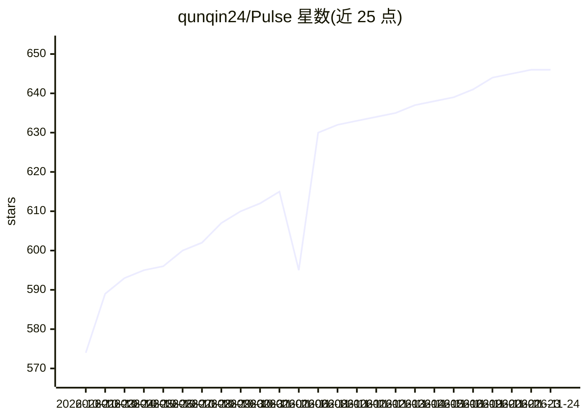

# qunqin24/Pulse

⭐ 646 · Swift · Apache-2.0 · 推送 2026-11-23 · [GitHub](https://github.com/qunqin24/Pulse) · [官网](https://github.com/qunqin24/Pulse/releases/latest) · 个人维护 · 中文 README

**屏幕边缘显示 78 个 AI 编码工具用量额度的 macOS 监控**

开源的 macOS 原生应用（Swift/SwiftUI），常驻屏幕边缘或菜单栏，以环形指示器展示 Claude Code、Codex、Cursor、GitHub Copilot 等 78 个 AI 编码服务的用量额度。读取方式按各服务自身机制：官方用量端点、编辑器登录凭据、本地语言服务器或粘贴的密钥，百分比取自服务自报数值，估算项单独标注。无自有账号与服务端，密钥加密存于本机。悬停查看各额度与重置时间，附消耗速率预测、Token 花费统计（按日/模型/agent）、44 个服务商状态页监控。需 macOS 14+，支持 Apple Silicon 与 Intel，界面 6 种语言。

## 筛选速览

| 维度 | 判定 | 备注 |
|---|---|---|
| AI 角色 | `ai-ecosystem` | LLM/agent 周边工具 |
| 许可风险 | `permissive` | Apache-2.0 |
| 部署形态 | `desktop` | 安装包/桌面程序 |
| 模型依赖 | — | README 未给出锁定关系 |
| 硬件要求 | — | 无带数字的原话,不猜 |
| 安装摩擦 | `low` | 无编译、无系统依赖或容器化 |
| 成熟度 | — | 结构信号不足 |

## 能力要点

- 78 个 AI 编码服务的用量环，数值取自服务自报
- 无自有账号与服务端，凭据加密存本机
- 消耗速率预测与按日/模型/agent 的 Token 花费统计
- 44 个服务商状态页监控与中断通知

## 适用场景

- 同时使用多个 AI 编码订阅时集中查看剩余额度
- 避免用量触顶造成的意外限流
- 统计本机各客户端的 Token 花费与折算成本
- 监控所用服务商是否发生故障

## 场景标签

 · 领域:开发者工具/监控

## 证据(README 行号)

> L5:  Know how much Claude Code, Codex and Cursor you have left — without opening a single usage page.
> L23: - **Seventy-eight services at a glance** — Claude Code, Codex, Cursor, GitHub Copilot, Antigravity, Kiro, Grok, Dee
> L86: 78 services, each read the way the product itself works — its own usage endpoint, the editor's login, a local langu

## 星数曲线

2026-10-21 574 → 2026-11-24 646（+72）

---
*卡片 v1 · prompt 1.4 · 生成 2026-11-24 · 置信度 high · 依据 README sha `d75f361a0a9b` · [字段定义](../../DATASET.md)*
